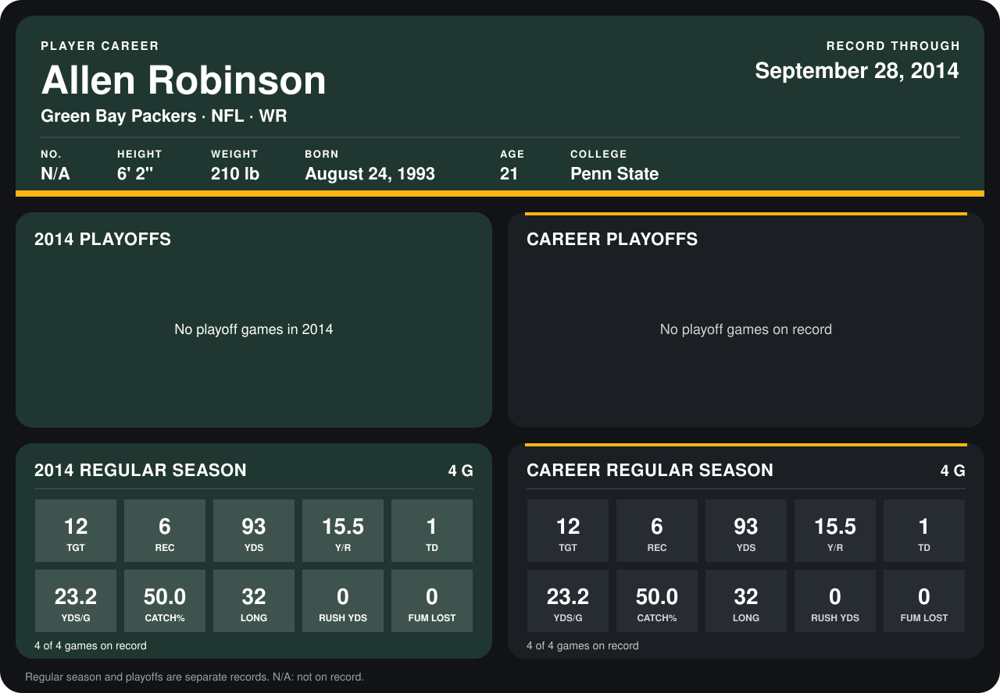

# Allen Robinson

## Career stats

### Regular season

| Season | Team | Age | # | G | TGT | REC | YDS | Y/R | TD | YDS/G | CATCH% | LONG | RUSH YDS | FUM LOST |
|---|---|---:|---:|---:|---:|---:|---:|---:|---:|---:|---:|---:|---:|---:|
| 2014 | Green Bay Packers | 21 | N/A | 5 | 13 | 6 | 93 | 15.5 | 1 | 18.6 | 46.2 | 32 | 0 | 0 |
| **Career** |  |  |  | 5 | 13 | 6 | 93 | 15.5 | 1 | 18.6 | 46.2 | 32 | 0 | 0 |

### Playoffs

No playoff games on record.

## Awards

None on record.

Age is his age on the league's opening game of each season; # is the number listed for him that season with that team (2014: the card's rule; 2013: the 2013 season roster), N/A where no listing applies.

Records through October 2, 2014. Identity: listed 2014 roster data, Weeks 1-4. [All Green Bay Packers players](README.md).
