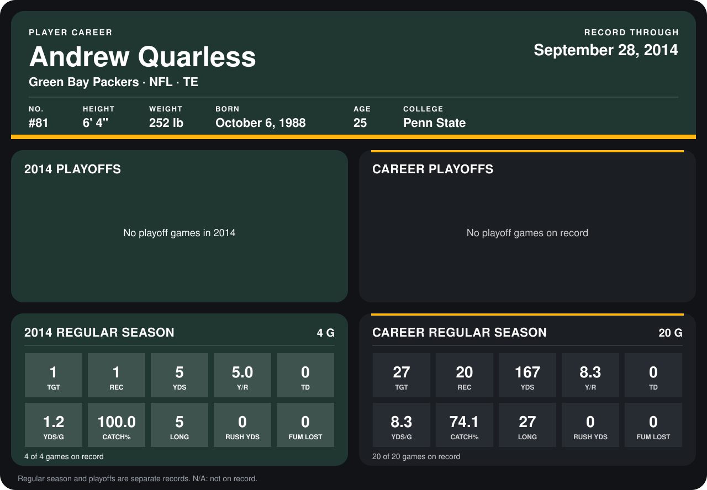

# Andrew Quarless

## Career stats

### Regular season

| Season | Club | G | TGT | REC | YDS | Y/R | TD | YDS/G | CATCH% | LONG | RUSH YDS | FUM LOST |
|---|---|---:|---:|---:|---:|---:|---:|---:|---:|---:|---:|---:|
| 2013 | Green Bay Packers | 16 | 26 | 19 | 162 | 8.5 | 0 | 10.1 | 73.1 | 27 | 0 | 0 |
| 2014 | Green Bay Packers | 5 | 1 | 1 | 5 | 5.0 | 0 | 1.0 | 100.0 | 5 | 0 | 0 |
| **Career** |  | 21 | 27 | 20 | 167 | 8.3 | 0 | 8.0 | 74.1 | 27 | 0 | 0 |

### Playoffs

No playoff games on record.

## Awards

None on record.

Records through October 2, 2014. Identity: listed 2014 roster data, Weeks 1-4; number: 2014 Week 1 roster. [All Green Bay Packers players](README.md).
