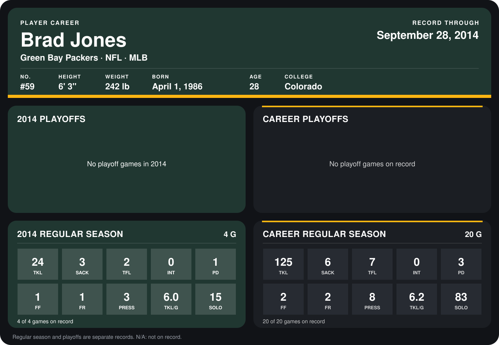

# Brad Jones

## Career stats

### Regular season

| Season | Club | G | TKL | SACK | TFL | INT | PD | FF | FR | PRESS | TKL/G | SOLO |
|---|---|---:|---:|---:|---:|---:|---:|---:|---:|---:|---:|---:|
| 2013 | Green Bay Packers | 16 | 101 | 3 | 5 | 0 | 2 | 1 | 1 | 5 | 6.3 | 68 |
| 2014 | Green Bay Packers | 5 | 24 | 3 | 2 | 0 | 1 | 1 | 1 | 3 | 4.8 | 15 |
| **Career** |  | 21 | 125 | 6 | 7 | 0 | 3 | 2 | 2 | 8 | 6.0 | 83 |

### Playoffs

No playoff games on record.

## Awards

None on record.

Records through October 2, 2014. Identity: listed 2014 roster data, Weeks 1-4; number: 2014 Week 1 roster. [All Green Bay Packers players](README.md).
