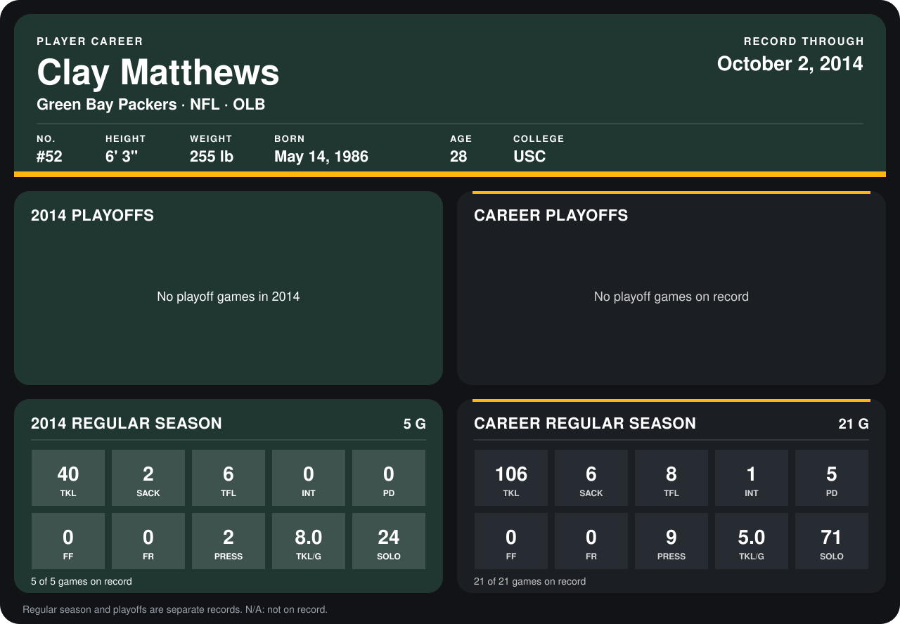

# Clay Matthews

## Career stats

### Regular season

| Season | Club | G | TKL | SACK | TFL | INT | PD | FF | FR | PRESS | TKL/G | SOLO |
|---|---|---:|---:|---:|---:|---:|---:|---:|---:|---:|---:|---:|
| 2013 | Green Bay Packers | 16 | 66 | 4 | 2 | 1 | 5 | 0 | 0 | 7 | 4.1 | 47 |
| 2014 | Green Bay Packers | 4 | 35 | 2 | 5 | 0 | 0 | 0 | 0 | 2 | 8.8 | 22 |
| **Career** |  | 20 | 101 | 6 | 7 | 1 | 5 | 0 | 0 | 9 | 5.0 | 69 |

### Playoffs

No playoff games on record.

## Awards

None on record.

Records through September 29, 2014. Identity: listed 2014 roster data, Weeks 1-4; number: 2014 Week 1 roster. [All Green Bay Packers players](README.md).
