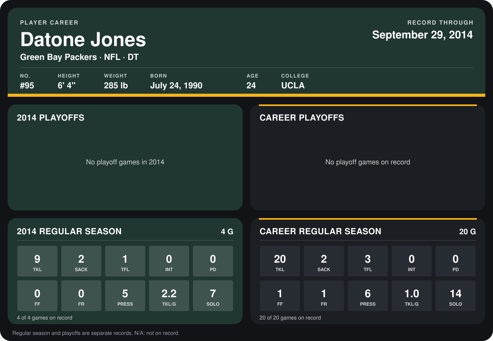

# Datone Jones

## Career stats

### Regular season

| Season | Club | G | TKL | SACK | TFL | INT | PD | FF | FR | PRESS | TKL/G | SOLO |
|---|---|---:|---:|---:|---:|---:|---:|---:|---:|---:|---:|---:|
| 2013 | Green Bay Packers | 16 | 11 | 0 | 2 | 0 | 0 | 1 | 1 | 1 | 0.7 | 7 |
| 2014 | Green Bay Packers | 5 | 12 | 3 | 1 | 0 | 0 | 0 | 0 | 6 | 2.4 | 8 |
| **Career** |  | 21 | 23 | 3 | 3 | 0 | 0 | 1 | 1 | 7 | 1.1 | 15 |

### Playoffs

No playoff games on record.

## Awards

None on record.

Records through October 2, 2014. Identity: listed 2014 roster data, Weeks 1-4; number: 2014 Week 1 roster. [All Green Bay Packers players](README.md).
