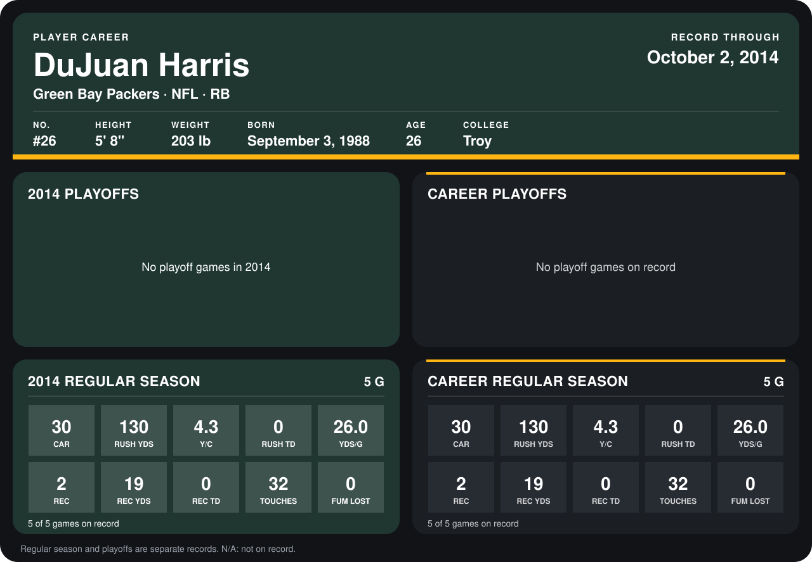

# DuJuan Harris

## Career stats

### Regular season

| Season | Club | G | CAR | RUSH YDS | Y/C | RUSH TD | YDS/G | REC | REC YDS | REC TD | TOUCHES | FUM LOST |
|---|---|---:|---:|---:|---:|---:|---:|---:|---:|---:|---:|---:|
| 2014 | Green Bay Packers | 5 | 30 | 130 | 4.3 | 0 | 26.0 | 2 | 19 | 0 | 32 | 0 |
| **Career** |  | 5 | 30 | 130 | 4.3 | 0 | 26.0 | 2 | 19 | 0 | 32 | 0 |

### Playoffs

No playoff games on record.

## Awards

None on record.

Records through October 2, 2014. Identity: listed 2014 roster data, Weeks 1-4; number: 2014 Week 1 roster. [All Green Bay Packers players](README.md).
