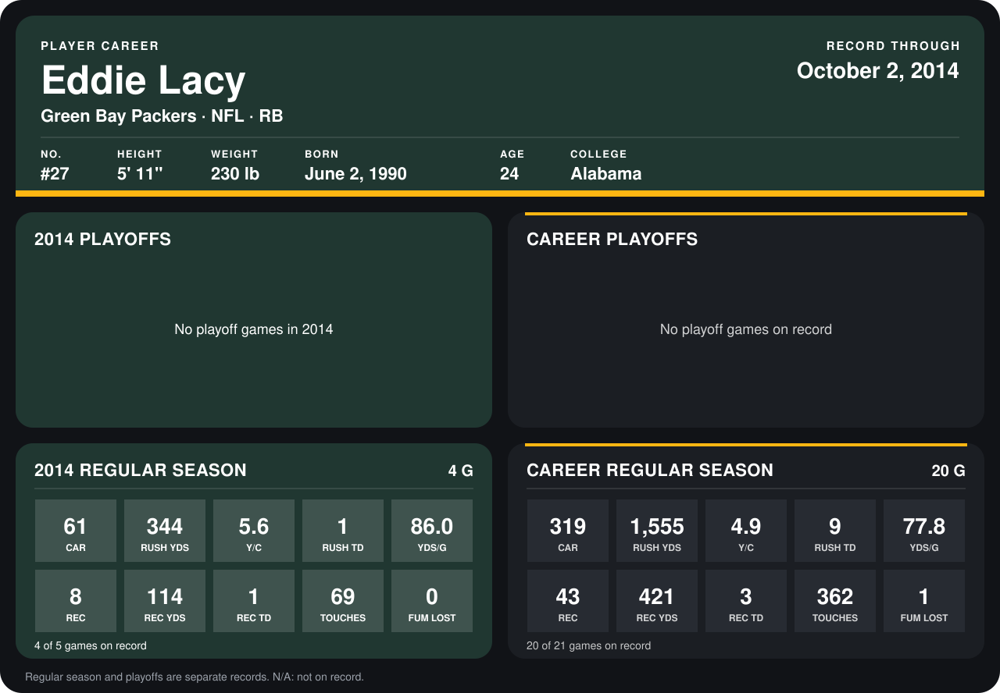

# Eddie Lacy

## Career stats

### Regular season

| Season | Club | G | CAR | RUSH YDS | Y/C | RUSH TD | YDS/G | REC | REC YDS | REC TD | TOUCHES | FUM LOST |
|---|---|---:|---:|---:|---:|---:|---:|---:|---:|---:|---:|---:|
| 2013 | Green Bay Packers | 16 | 258 | 1,211 | 4.7 | 8 | 75.7 | 35 | 307 | 2 | 293 | 1 |
| 2014 | Green Bay Packers | 4 | 61 | 344 | 5.6 | 1 | 86.0 | 8 | 114 | 1 | 69 | 0 |
| **Career** |  | 20 | 319 | 1,555 | 4.9 | 9 | 77.8 | 43 | 421 | 3 | 362 | 1 |

### Playoffs

No playoff games on record.

## Awards

None on record.

Records through October 2, 2014. Identity: listed 2014 roster data, Weeks 1-4; number: 2014 Week 1 roster. [All Green Bay Packers players](README.md).
