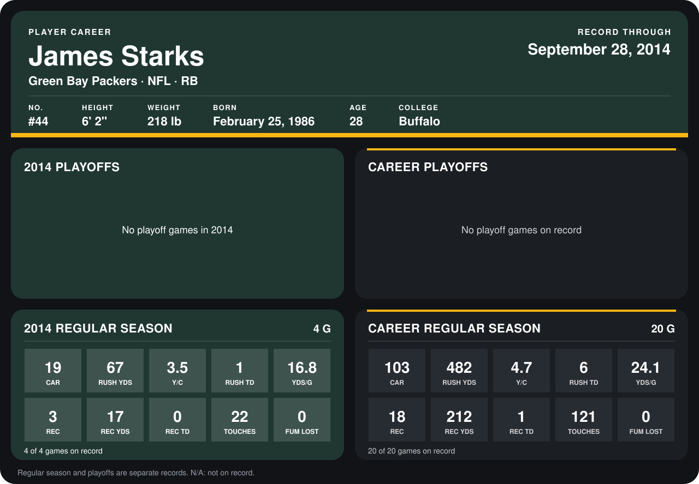

# James Starks

## Career stats

### Regular season

| Season | Club | G | CAR | RUSH YDS | Y/C | RUSH TD | YDS/G | REC | REC YDS | REC TD | TOUCHES | FUM LOST |
|---|---|---:|---:|---:|---:|---:|---:|---:|---:|---:|---:|---:|
| 2013 | Green Bay Packers | 16 | 84 | 415 | 4.9 | 5 | 25.9 | 15 | 195 | 1 | 99 | 0 |
| 2014 | Green Bay Packers | 4 | 19 | 67 | 3.5 | 1 | 16.8 | 3 | 17 | 0 | 22 | 0 |
| **Career** |  | 20 | 103 | 482 | 4.7 | 6 | 24.1 | 18 | 212 | 1 | 121 | 0 |

### Playoffs

No playoff games on record.

## Awards

None on record.

Records through September 29, 2014. Identity: listed 2014 roster data, Weeks 1-4; number: 2014 Week 1 roster. [All Green Bay Packers players](README.md).
