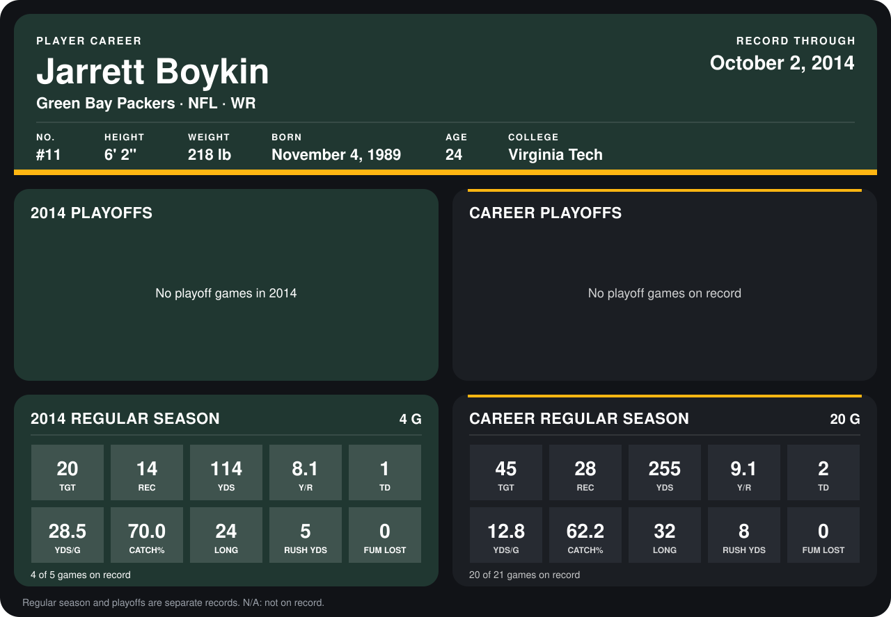

# Jarrett Boykin

## Career stats

### Regular season

| Season | Club | G | TGT | REC | YDS | Y/R | TD | YDS/G | CATCH% | LONG | RUSH YDS | FUM LOST |
|---|---|---:|---:|---:|---:|---:|---:|---:|---:|---:|---:|---:|
| 2013 | Green Bay Packers | 16 | 25 | 14 | 141 | 10.1 | 1 | 8.8 | 56.0 | 32 | 3 | 0 |
| 2014 | Green Bay Packers | 3 | 13 | 9 | 84 | 9.3 | 1 | 28.0 | 69.2 | 24 | 5 | 0 |
| **Career** |  | 19 | 38 | 23 | 225 | 9.8 | 2 | 11.8 | 60.5 | 32 | 8 | 0 |

### Playoffs

No playoff games on record.

## Awards

None on record.

Records through September 29, 2014. Identity: listed 2014 roster data, Weeks 1-4; number: 2014 Week 1 roster. [All Green Bay Packers players](README.md).
