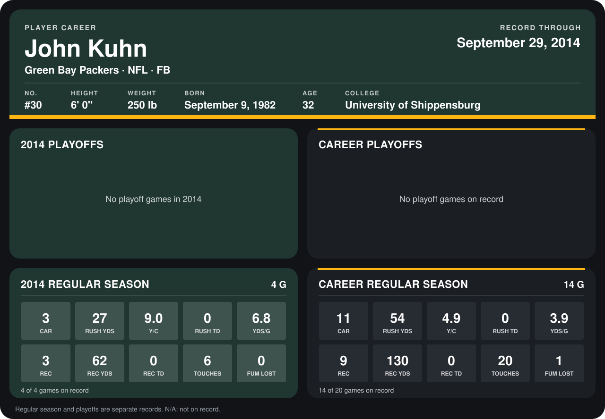

# John Kuhn

## Career stats

### Regular season

| Season | Club | G | CAR | RUSH YDS | Y/C | RUSH TD | YDS/G | REC | REC YDS | REC TD | TOUCHES | FUM LOST |
|---|---|---:|---:|---:|---:|---:|---:|---:|---:|---:|---:|---:|
| 2013 | Green Bay Packers | 10 | 8 | 27 | 3.4 | 0 | 2.7 | 6 | 68 | 0 | 14 | 1 |
| 2014 | Green Bay Packers | 5 | 3 | 27 | 9.0 | 0 | 5.4 | 3 | 62 | 0 | 6 | 0 |
| **Career** |  | 15 | 11 | 54 | 4.9 | 0 | 3.6 | 9 | 130 | 0 | 20 | 1 |

### Playoffs

No playoff games on record.

## Awards

None on record.

Records through October 2, 2014. Identity: listed 2014 roster data, Weeks 1-4; number: 2014 Week 1 roster. [All Green Bay Packers players](README.md).
