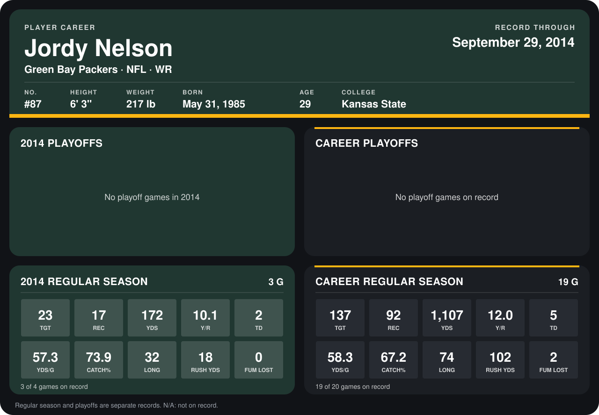

# Jordy Nelson

## Career stats

### Regular season

| Season | Team | Age | # | G | TGT | REC | YDS | Y/R | TD | YDS/G | CATCH% | LONG | RUSH YDS | FUM LOST |
|---|---|---:|---:|---:|---:|---:|---:|---:|---:|---:|---:|---:|---:|---:|
| 2013 | Green Bay Packers | 28 | 87 | 16 | 114 | 75 | 935 | 12.5 | 3 | 58.4 | 65.8 | 74 | 84 | 2 |
| 2014 | Green Bay Packers | 29 | 87 | 3 | 23 | 17 | 172 | 10.1 | 2 | 57.3 | 73.9 | 32 | 18 | 0 |
| **Career** |  |  |  | 19 | 137 | 92 | 1,107 | 12.0 | 5 | 58.3 | 67.2 | 74 | 102 | 2 |

### Playoffs

No playoff games on record.

## Awards

None on record.

Age is his age on the league's opening game of each season; # is the number listed for him that season with that team (2014: the card's rule; 2013: the 2013 season roster), N/A where no listing applies.

Records through September 28, 2014. Identity: listed 2014 roster data, Weeks 1-4; number: 2014 Week 1 roster. [All Green Bay Packers players](README.md).
