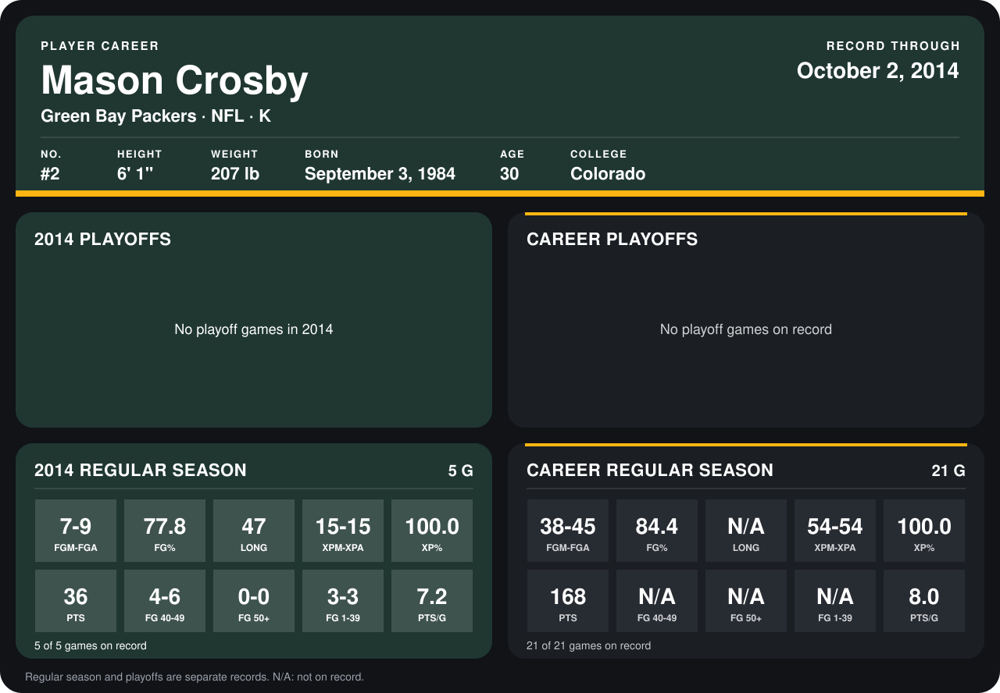

# Mason Crosby

## Career stats

### Regular season

| Season | Club | G | FGM-FGA | FG% | LONG | XPM-XPA | XP% | PTS | FG 40-49 | FG 50+ | FG 1-39 | PTS/G |
|---|---|---:|---:|---:|---:|---:|---:|---:|---:|---:|---:|---:|
| 2013 | Green Bay Packers | 16 | 31-36 | 86.1 | N/A | 39-39 | 100.0 | 132 | N/A | N/A | N/A | 8.2 |
| 2014 | Green Bay Packers | 5 | 7-9 | 77.8 | 47 | 15-15 | 100.0 | 36 | 4-6 | 0-0 | 3-3 | 7.2 |
| **Career** |  | 21 | 38-45 | 84.4 | N/A | 54-54 | 100.0 | 168 | N/A | N/A | N/A | 8.0 |

### Playoffs

No playoff games on record.

## Awards

- NFC Special Teams Player of the Week (2013, Week 9)
- NFC Special Teams Player of the Week (2014, Week 2)

Records through October 2, 2014. Identity: listed 2014 roster data, Weeks 1-4; number: 2014 Week 1 roster. [All Green Bay Packers players](README.md).
