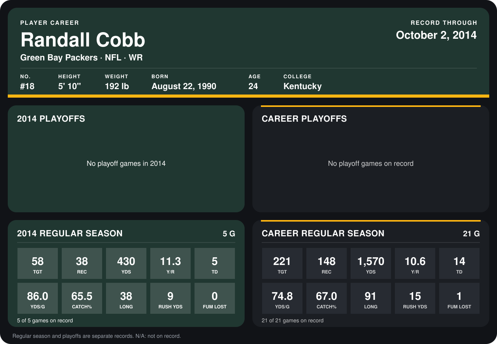

# Randall Cobb

## Career stats

### Regular season

| Season | Club | G | TGT | REC | YDS | Y/R | TD | YDS/G | CATCH% | LONG | RUSH YDS | FUM LOST |
|---|---|---:|---:|---:|---:|---:|---:|---:|---:|---:|---:|---:|
| 2013 | Green Bay Packers | 16 | 163 | 110 | 1,140 | 10.4 | 9 | 71.2 | 67.5 | 91 | 6 | 1 |
| 2014 | Green Bay Packers | 5 | 58 | 38 | 430 | 11.3 | 5 | 86.0 | 65.5 | 38 | 9 | 0 |
| **Career** |  | 21 | 221 | 148 | 1,570 | 10.6 | 14 | 74.8 | 67.0 | 91 | 15 | 1 |

### Playoffs

No playoff games on record.

## Awards

None on record.

Records through October 2, 2014. Identity: listed 2014 roster data, Weeks 1-4; number: 2014 Week 1 roster. [All Green Bay Packers players](README.md).
