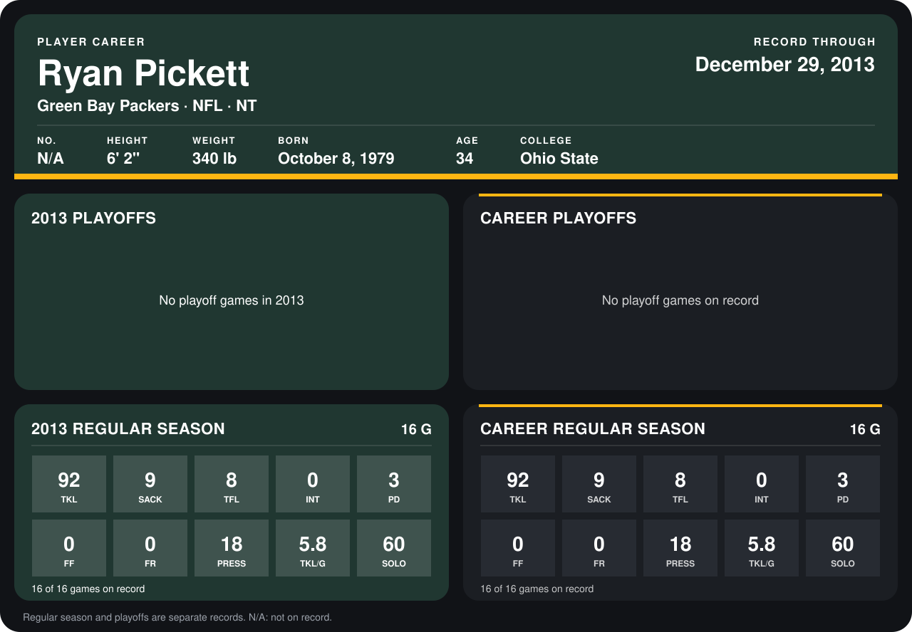

# Ryan Pickett

## Career stats

### Regular season

| Season | Club | G | TKL | SACK | TFL | INT | PD | FF | FR | PRESS | TKL/G | SOLO |
|---|---|---:|---:|---:|---:|---:|---:|---:|---:|---:|---:|---:|
| 2013 | Green Bay Packers | 16 | 92 | 9 | 8 | 0 | 3 | 0 | 0 | 18 | 5.8 | 60 |
| **Career** |  | 16 | 92 | 9 | 8 | 0 | 3 | 0 | 0 | 18 | 5.8 | 60 |

### Playoffs

No playoff games on record.

## Awards

- NFC Defensive Player of the Week (2013, Week 6)
- Pro Bowl selection (2013, DT)

Records through September 29, 2014. Identity: listed 2014 roster data, Weeks 1-4. [All Green Bay Packers players](README.md).
