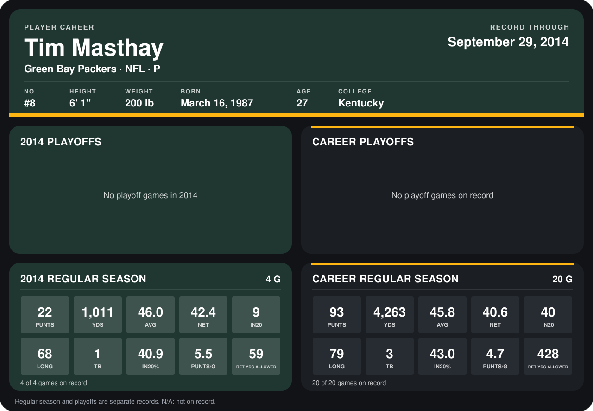

# Tim Masthay

## Career stats

### Regular season

| Season | Team | Age | # | G | PUNTS | YDS | AVG | NET | IN20 | LONG | TB | IN20% | PUNTS/G | RET YDS ALLOWED |
|---|---|---:|---:|---:|---:|---:|---:|---:|---:|---:|---:|---:|---:|---:|
| 2013 | Green Bay Packers | 26 | 8 | 16 | 71 | 3,252 | 45.8 | 40.0 | 31 | 79 | 2 | 43.7 | 4.4 | 369 |
| 2014 | Green Bay Packers | 27 | 8 | 4 | 22 | 1,011 | 46.0 | 42.4 | 9 | 68 | 1 | 40.9 | 5.5 | 59 |
| **Career** |  |  |  | 20 | 93 | 4,263 | 45.8 | 40.6 | 40 | 79 | 3 | 43.0 | 4.7 | 428 |

### Playoffs

No playoff games on record.

## Awards

- Pro Bowl selection, replacement (2013, P)

Age is his age on the league's opening game of each season; # is the number listed for him that season with that team (2014: the card's rule; 2013: the 2013 season roster), N/A where no listing applies.

Records through September 28, 2014. Identity: listed 2014 roster data, Weeks 1-4; number: 2014 Week 1 roster. [All Green Bay Packers players](README.md).
