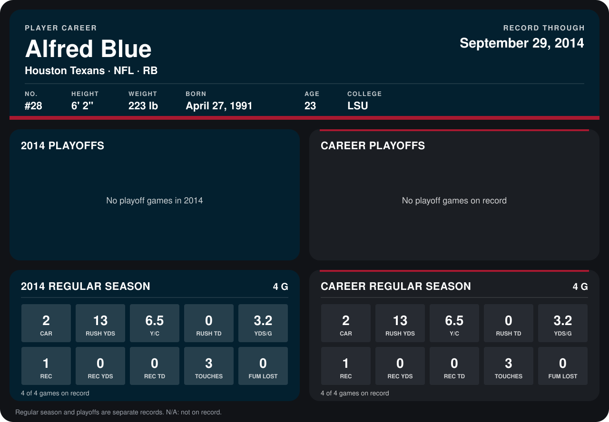

# Alfred Blue

## Career stats

### Regular season

| Season | Club | G | CAR | RUSH YDS | Y/C | RUSH TD | YDS/G | REC | REC YDS | REC TD | TOUCHES | FUM LOST |
|---|---|---:|---:|---:|---:|---:|---:|---:|---:|---:|---:|---:|
| 2014 | Houston Texans | 4 | 2 | 13 | 6.5 | 0 | 3.2 | 1 | 0 | 0 | 3 | 0 |
| **Career** |  | 4 | 2 | 13 | 6.5 | 0 | 3.2 | 1 | 0 | 0 | 3 | 0 |

### Playoffs

No playoff games on record.

## Awards

None on record.

Records through September 29, 2014. Identity: listed 2014 roster data, Weeks 1-4; number: 2014 Week 1 roster. [All Houston Texans players](README.md).
