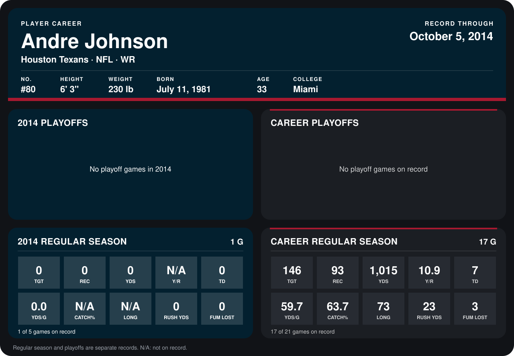

# Andre Johnson

## Career stats

### Regular season

| Season | Team | Age | # | G | TGT | REC | YDS | Y/R | TD | YDS/G | CATCH% | LONG | RUSH YDS | FUM LOST |
|---|---|---:|---:|---:|---:|---:|---:|---:|---:|---:|---:|---:|---:|---:|
| 2013 | Houston Texans | 32 | 80 | 16 | 146 | 93 | 1,015 | 10.9 | 7 | 63.4 | 63.7 | 73 | 23 | 3 |
| 2014 | Houston Texans | 33 | 80 | 1 | 0 | 0 | 0 | N/A | 0 | 0.0 | N/A | N/A | 0 | 0 |
| **Career** |  |  |  | 17 | 146 | 93 | 1,015 | 10.9 | 7 | 59.7 | 63.7 | 73 | 23 | 3 |

### Playoffs

No playoff games on record.

## Awards

None on record.

Age is his age on the league's opening game of each season; # is the number listed for him that season with that team (2014: the card's rule; 2013: the 2013 season roster), N/A where no listing applies.

Records through October 5, 2014. Identity: listed 2014 roster data, Weeks 1-4; number: 2014 Week 4 roster listing. [All Houston Texans players](README.md).
