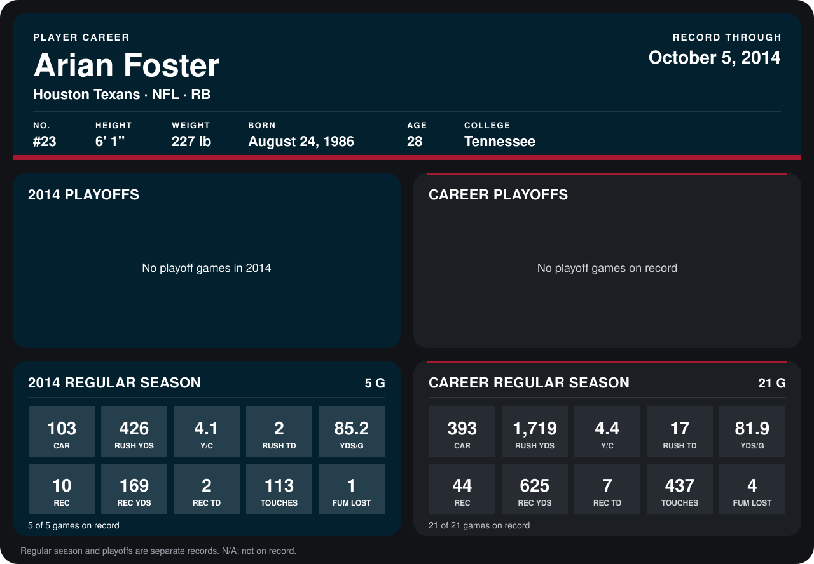

# Arian Foster

## Career stats

### Regular season

| Season | Team | Age | # | G | CAR | RUSH YDS | Y/C | RUSH TD | YDS/G | REC | REC YDS | REC TD | TOUCHES | FUM LOST |
|---|---|---:|---:|---:|---:|---:|---:|---:|---:|---:|---:|---:|---:|---:|
| 2013 | Houston Texans | 27 | 23 | 16 | 290 | 1,293 | 4.5 | 15 | 80.8 | 34 | 456 | 5 | 324 | 3 |
| 2014 | Houston Texans | 28 | 23 | 5 | 103 | 426 | 4.1 | 2 | 85.2 | 10 | 169 | 2 | 113 | 1 |
| **Career** |  |  |  | 21 | 393 | 1,719 | 4.4 | 17 | 81.9 | 44 | 625 | 7 | 437 | 4 |

### Playoffs

No playoff games on record.

## Awards

- AFC Offensive Player of the Week (2013, Week 4)
- AP Second-Team All-Pro (2013, RB)
- Pro Bowl selection (2013, RB)

Age is his age on the league's opening game of each season; # is the number listed for him that season with that team (2014: the card's rule; 2013: the 2013 season roster), N/A where no listing applies.

Records through October 5, 2014. Identity: listed 2014 roster data, Weeks 1-4; number: 2014 Week 1 roster. [All Houston Texans players](README.md).
