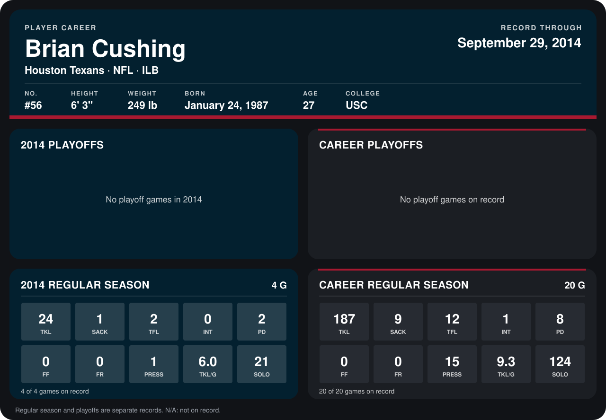

# Brian Cushing

## Career stats

### Regular season

| Season | Team | Age | # | G | TKL | SACK | TFL | INT | PD | FF | FR | PRESS | TKL/G | SOLO |
|---|---|---:|---:|---:|---:|---:|---:|---:|---:|---:|---:|---:|---:|---:|
| 2013 | Houston Texans | 26 | 56 | 16 | 163 | 8 | 10 | 1 | 6 | 0 | 0 | 14 | 10.2 | 103 |
| 2014 | Houston Texans | 27 | 56 | 4 | 24 | 1 | 2 | 0 | 2 | 0 | 0 | 1 | 6.0 | 21 |
| **Career** |  |  |  | 20 | 187 | 9 | 12 | 1 | 8 | 0 | 0 | 15 | 9.3 | 124 |

### Playoffs

No playoff games on record.

## Awards

- AFC Defensive Player of the Week (2013, Week 17)

Age is his age on the league's opening game of each season; # is the number listed for him that season with that team (2014: the card's rule; 2013: the 2013 season roster), N/A where no listing applies.

Records through September 28, 2014. Identity: listed 2014 roster data, Weeks 1-4; number: 2014 Week 1 roster. [All Houston Texans players](README.md).
