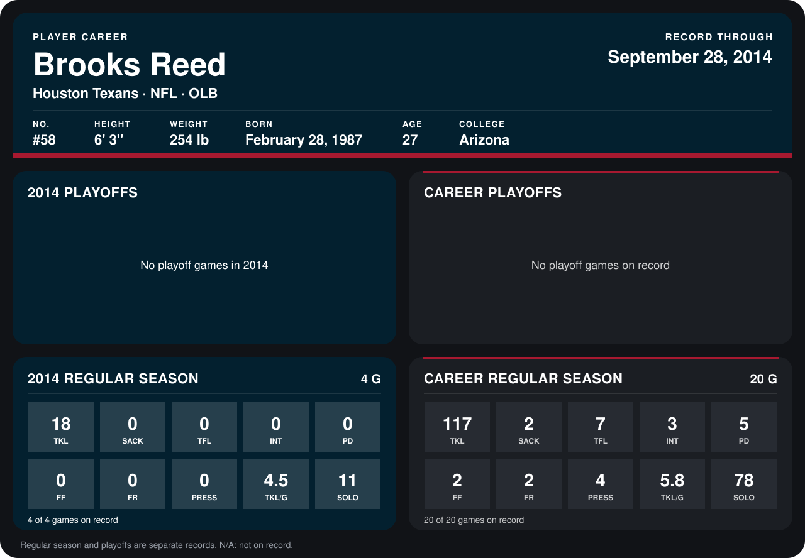

# Brooks Reed

## Career stats

### Regular season

| Season | Club | G | TKL | SACK | TFL | INT | PD | FF | FR | PRESS | TKL/G | SOLO |
|---|---|---:|---:|---:|---:|---:|---:|---:|---:|---:|---:|---:|
| 2013 | Houston Texans | 16 | 99 | 2 | 7 | 3 | 5 | 2 | 2 | 4 | 6.2 | 67 |
| 2014 | Houston Texans | 4 | 18 | 0 | 0 | 0 | 0 | 0 | 0 | 0 | 4.5 | 11 |
| **Career** |  | 20 | 117 | 2 | 7 | 3 | 5 | 2 | 2 | 4 | 5.8 | 78 |

### Playoffs

No playoff games on record.

## Awards

None on record.

Records through September 29, 2014. Identity: listed 2014 roster data, Weeks 1-4; number: 2014 Week 1 roster. [All Houston Texans players](README.md).
