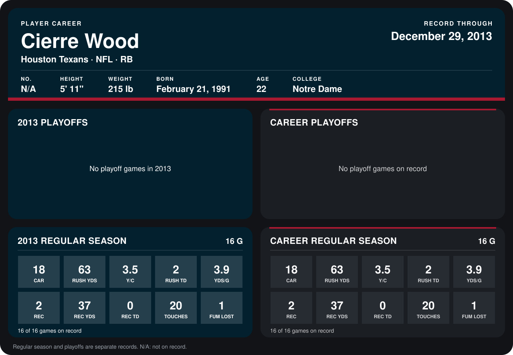

# Cierre Wood

## Career stats

### Regular season

| Season | Club | G | CAR | RUSH YDS | Y/C | RUSH TD | YDS/G | REC | REC YDS | REC TD | TOUCHES | FUM LOST |
|---|---|---:|---:|---:|---:|---:|---:|---:|---:|---:|---:|---:|
| 2013 | Houston Texans | 16 | 18 | 63 | 3.5 | 2 | 3.9 | 2 | 37 | 0 | 20 | 1 |
| **Career** |  | 16 | 18 | 63 | 3.5 | 2 | 3.9 | 2 | 37 | 0 | 20 | 1 |

### Playoffs

No playoff games on record.

## Awards

None on record.

Records through September 29, 2014. Identity: the public player file's latest listing (no 2014 Weeks 1-4 roster row). [All Houston Texans players](README.md).
