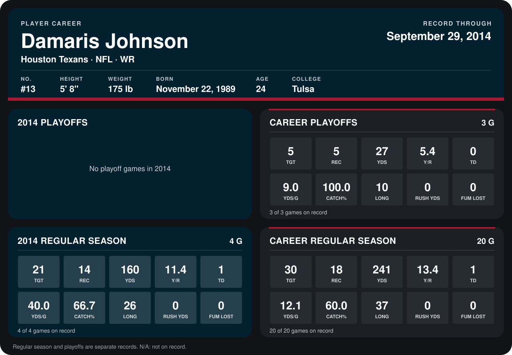

# Damaris Johnson

## Career stats

### Regular season

| Season | Team | Age | # | G | TGT | REC | YDS | Y/R | TD | YDS/G | CATCH% | LONG | RUSH YDS | FUM LOST |
|---|---|---:|---:|---:|---:|---:|---:|---:|---:|---:|---:|---:|---:|---:|
| 2013 | Philadelphia Eagles | 23 | 13 | 16 | 9 | 4 | 81 | 20.2 | 0 | 5.1 | 44.4 | 37 | 0 | 0 |
| 2014 | Houston Texans | 24 | 13 | 5 | 26 | 18 | 197 | 10.9 | 1 | 39.4 | 69.2 | 26 | 0 | 0 |
| **Career** |  |  |  | 21 | 35 | 22 | 278 | 12.6 | 1 | 13.2 | 62.9 | 37 | 0 | 0 |

### Playoffs

| Season | Team | Age | # | G | TGT | REC | YDS | Y/R | TD | YDS/G | CATCH% | LONG | RUSH YDS | FUM LOST |
|---|---|---:|---:|---:|---:|---:|---:|---:|---:|---:|---:|---:|---:|---:|
| 2013 | Philadelphia Eagles | 23 | 13 | 3 | 5 | 5 | 27 | 5.4 | 0 | 9.0 | 100.0 | 10 | 0 | 0 |
| **Career** |  |  |  | 3 | 5 | 5 | 27 | 5.4 | 0 | 9.0 | 100.0 | 10 | 0 | 0 |

## Awards

None on record.

Age is his age on the league's opening game of each season; # is the number listed for him that season with that team (2014: the card's rule; 2013: the 2013 season roster), N/A where no listing applies.

Records through October 5, 2014. Identity: listed 2014 roster data, Weeks 1-4; number: 2014 Week 1 roster. [All Houston Texans players](README.md).
