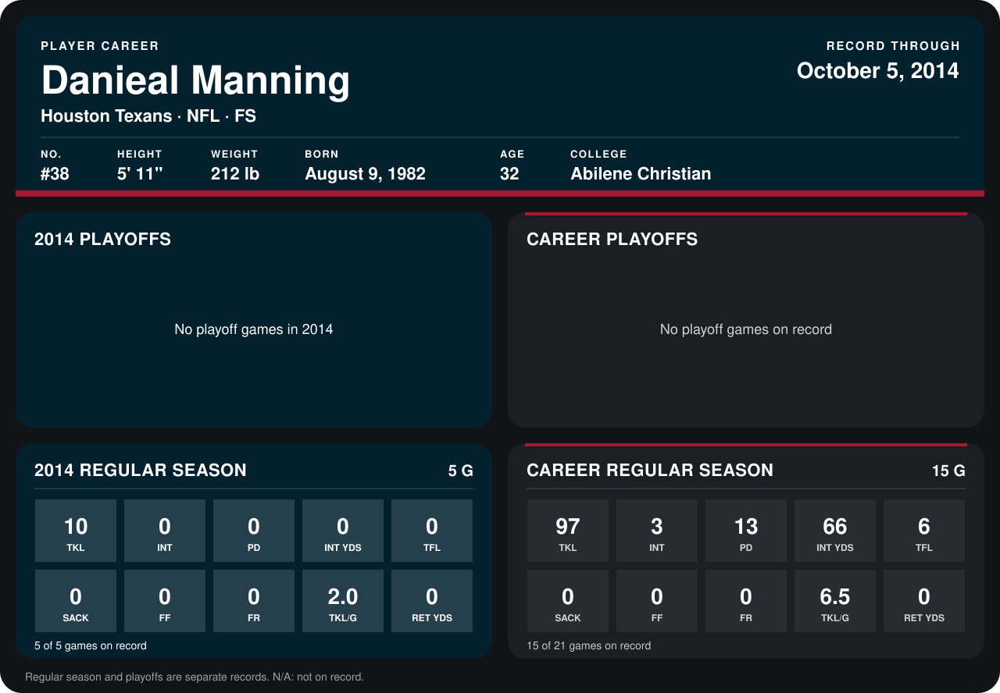

# Danieal Manning

## Career stats

### Regular season

| Season | Club | G | TKL | INT | PD | INT YDS | TFL | SACK | FF | FR | TKL/G | RET YDS |
|---|---|---:|---:|---:|---:|---:|---:|---:|---:|---:|---:|---:|
| 2013 | Houston Texans | 10 | 87 | 3 | 13 | 66 | 6 | 0 | 0 | 0 | 8.7 | 0 |
| 2014 | Houston Texans | 4 | 8 | 0 | 0 | 0 | 0 | 0 | 0 | 0 | 2.0 | 0 |
| **Career** |  | 14 | 95 | 3 | 13 | 66 | 6 | 0 | 0 | 0 | 6.8 | 0 |

### Playoffs

No playoff games on record.

## Awards

None on record.

Records through September 29, 2014. Identity: listed 2014 roster data, Weeks 1-4; number: 2014 Week 1 roster. [All Houston Texans players](README.md).
