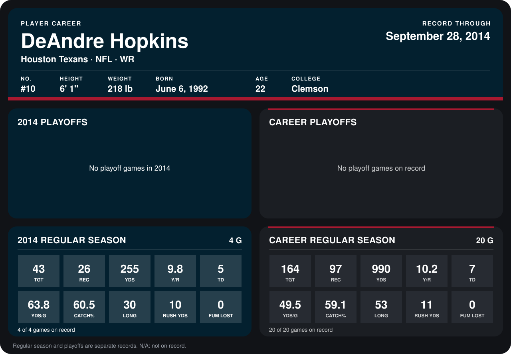

# DeAndre Hopkins

## Career stats

### Regular season

| Season | Club | G | TGT | REC | YDS | Y/R | TD | YDS/G | CATCH% | LONG | RUSH YDS | FUM LOST |
|---|---|---:|---:|---:|---:|---:|---:|---:|---:|---:|---:|---:|
| 2013 | Houston Texans | 16 | 121 | 71 | 735 | 10.4 | 2 | 45.9 | 58.7 | 53 | 1 | 0 |
| 2014 | Houston Texans | 4 | 43 | 26 | 255 | 9.8 | 5 | 63.8 | 60.5 | 30 | 10 | 0 |
| **Career** |  | 20 | 164 | 97 | 990 | 10.2 | 7 | 49.5 | 59.1 | 53 | 11 | 0 |

### Playoffs

No playoff games on record.

## Awards

None on record.

Records through September 28, 2014. Identity: listed 2014 roster data, Weeks 1-4; number: 2014 Week 1 roster. [All Houston Texans players](README.md).
