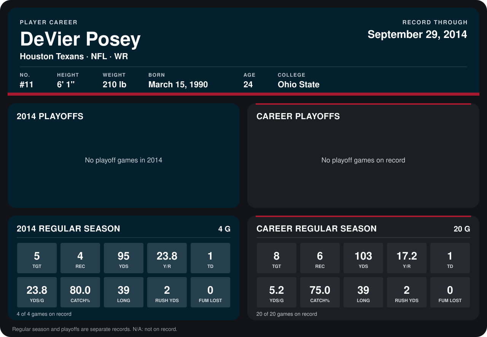

# DeVier Posey

## Career stats

### Regular season

| Season | Club | G | TGT | REC | YDS | Y/R | TD | YDS/G | CATCH% | LONG | RUSH YDS | FUM LOST |
|---|---|---:|---:|---:|---:|---:|---:|---:|---:|---:|---:|---:|
| 2013 | Houston Texans | 16 | 3 | 2 | 8 | 4.0 | 0 | 0.5 | 66.7 | 5 | 0 | 0 |
| 2014 | Houston Texans | 4 | 5 | 4 | 95 | 23.8 | 1 | 23.8 | 80.0 | 39 | 2 | 0 |
| **Career** |  | 20 | 8 | 6 | 103 | 17.2 | 1 | 5.2 | 75.0 | 39 | 2 | 0 |

### Playoffs

No playoff games on record.

## Awards

None on record.

Records through September 29, 2014. Identity: listed 2014 roster data, Weeks 1-4; number: 2014 Week 1 roster. [All Houston Texans players](README.md).
