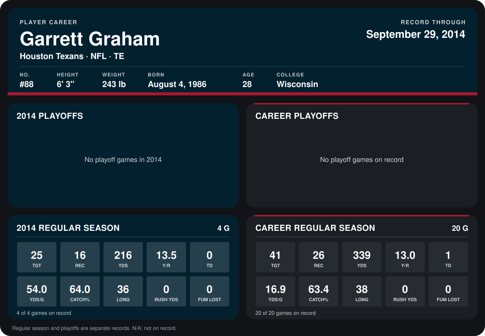

# Garrett Graham

## Career stats

### Regular season

| Season | Team | Age | # | G | TGT | REC | YDS | Y/R | TD | YDS/G | CATCH% | LONG | RUSH YDS | FUM LOST |
|---|---|---:|---:|---:|---:|---:|---:|---:|---:|---:|---:|---:|---:|---:|
| 2013 | Houston Texans | 27 | 88 | 16 | 16 | 10 | 123 | 12.3 | 1 | 7.7 | 62.5 | 38 | 0 | 0 |
| 2014 | Houston Texans | 28 | 88 | 5 | 28 | 17 | 221 | 13.0 | 0 | 44.2 | 60.7 | 36 | 0 | 0 |
| **Career** |  |  |  | 21 | 44 | 27 | 344 | 12.7 | 1 | 16.4 | 61.4 | 38 | 0 | 0 |

### Playoffs

No playoff games on record.

## Awards

None on record.

Age is his age on the league's opening game of each season; # is the number listed for him that season with that team (2014: the card's rule; 2013: the 2013 season roster), N/A where no listing applies.

Records through October 5, 2014. Identity: listed 2014 roster data, Weeks 1-4; number: 2014 Week 1 roster. [All Houston Texans players](README.md).
