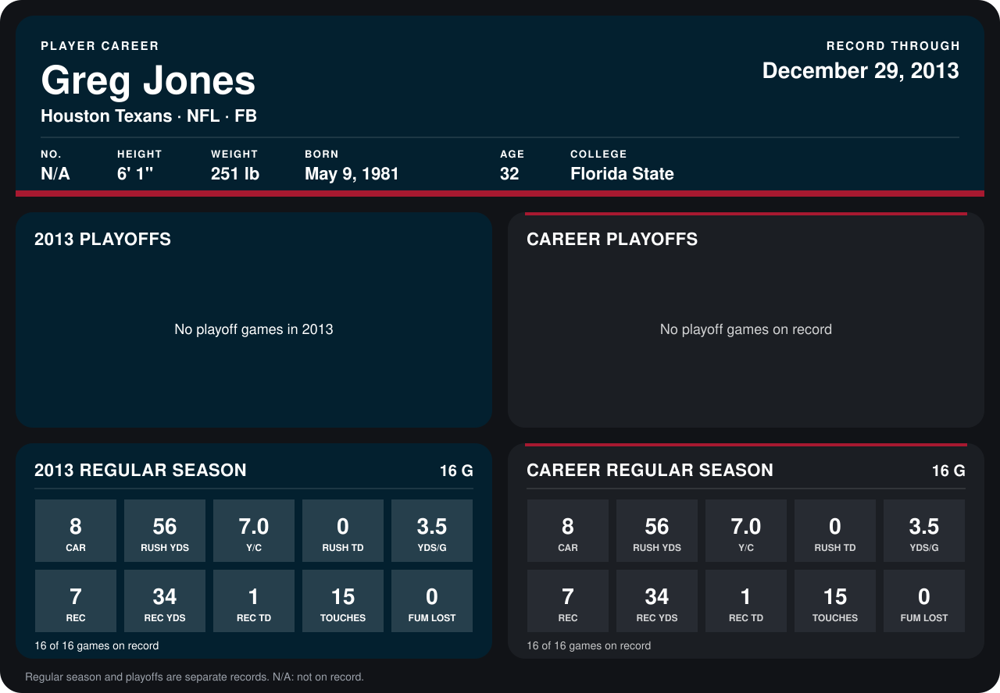

# Greg Jones

## Career stats

### Regular season

| Season | Team | Age | # | G | CAR | RUSH YDS | Y/C | RUSH TD | YDS/G | REC | REC YDS | REC TD | TOUCHES | FUM LOST |
|---|---|---:|---:|---:|---:|---:|---:|---:|---:|---:|---:|---:|---:|---:|
| 2013 | Houston Texans | 32 | 33 | 16 | 8 | 56 | 7.0 | 0 | 3.5 | 7 | 34 | 1 | 15 | 0 |
| **Career** |  |  |  | 16 | 8 | 56 | 7.0 | 0 | 3.5 | 7 | 34 | 1 | 15 | 0 |

### Playoffs

No playoff games on record.

## Awards

None on record.

Age is his age on the league's opening game of each season; # is the number listed for him that season with that team (2014: the card's rule; 2013: the 2013 season roster), N/A where no listing applies.

Records through December 29, 2013. Identity: his listed 2013 season roster data (no 2014 Weeks 1-4 roster row). [All Houston Texans players](README.md).
