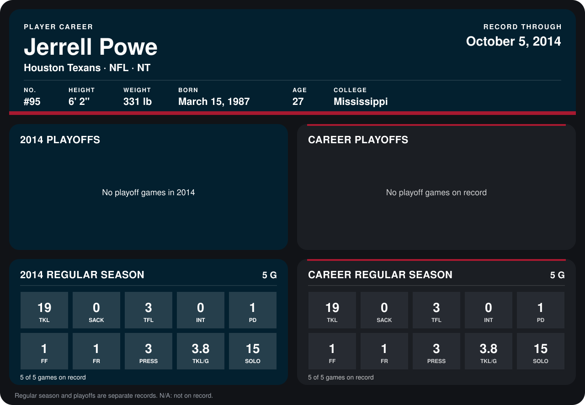

# Jerrell Powe

## Career stats

### Regular season

| Season | Club | G | TKL | SACK | TFL | INT | PD | FF | FR | PRESS | TKL/G | SOLO |
|---|---|---:|---:|---:|---:|---:|---:|---:|---:|---:|---:|---:|
| 2014 | Houston Texans | 5 | 19 | 0 | 3 | 0 | 1 | 1 | 1 | 3 | 3.8 | 15 |
| **Career** |  | 5 | 19 | 0 | 3 | 0 | 1 | 1 | 1 | 3 | 3.8 | 15 |

### Playoffs

No playoff games on record.

## Awards

None on record.

Records through October 5, 2014. Identity: listed 2014 roster data, Weeks 1-4; number: 2014 Week 1 roster. [All Houston Texans players](README.md).
