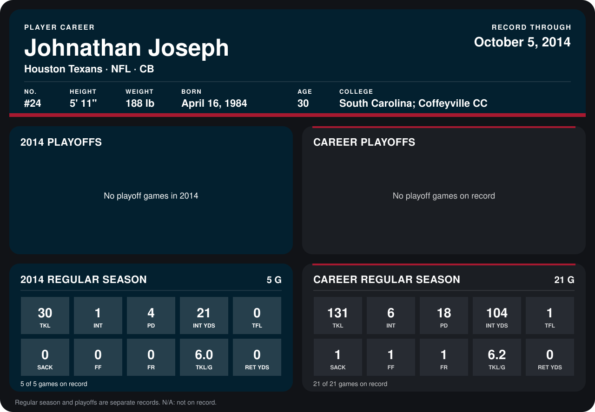

# Johnathan Joseph

## Career stats

### Regular season

| Season | Club | G | TKL | INT | PD | INT YDS | TFL | SACK | FF | FR | TKL/G | RET YDS |
|---|---|---:|---:|---:|---:|---:|---:|---:|---:|---:|---:|---:|
| 2013 | Houston Texans | 16 | 101 | 5 | 14 | 83 | 1 | 1 | 1 | 1 | 6.3 | 0 |
| 2014 | Houston Texans | 5 | 30 | 1 | 4 | 21 | 0 | 0 | 0 | 0 | 6.0 | 0 |
| **Career** |  | 21 | 131 | 6 | 18 | 104 | 1 | 1 | 1 | 1 | 6.2 | 0 |

### Playoffs

No playoff games on record.

## Awards

- Pro Bowl selection (2013, CB)

Records through October 5, 2014. Identity: listed 2014 roster data, Weeks 1-4; number: 2014 Week 1 roster. [All Houston Texans players](README.md).
