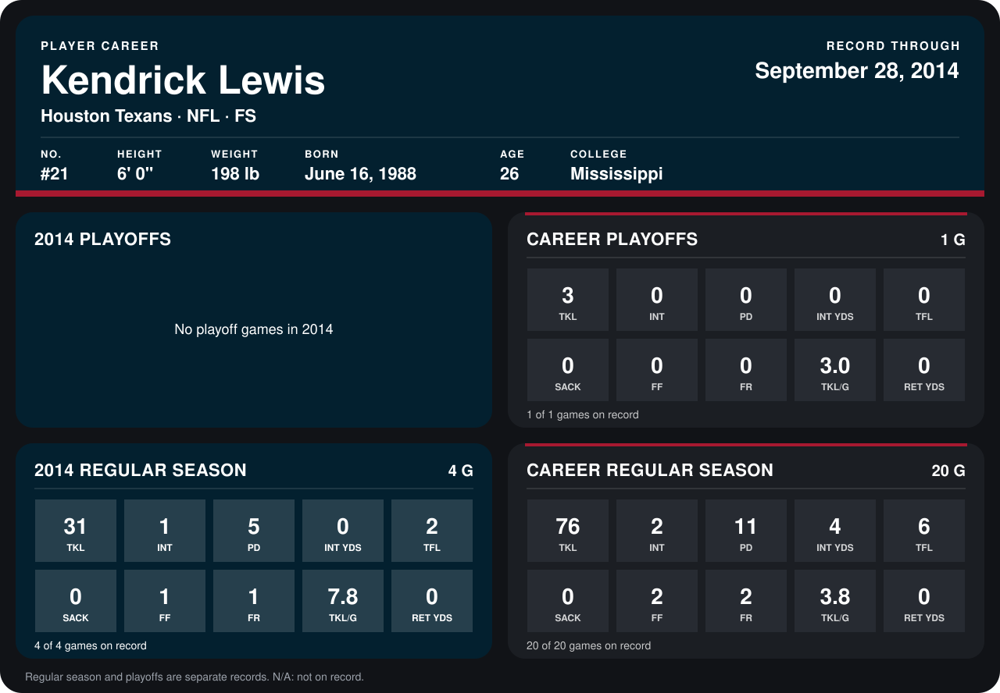

# Kendrick Lewis

## Career stats

### Regular season

| Season | Club | G | TKL | INT | PD | INT YDS | TFL | SACK | FF | FR | TKL/G | RET YDS |
|---|---|---:|---:|---:|---:|---:|---:|---:|---:|---:|---:|---:|
| 2013 | Kansas City Chiefs | 16 | 45 | 1 | 6 | 4 | 4 | 0 | 1 | 1 | 2.8 | 0 |
| 2014 | Houston Texans | 4 | 31 | 1 | 5 | 0 | 2 | 0 | 1 | 1 | 7.8 | 0 |
| **Career** |  | 20 | 76 | 2 | 11 | 4 | 6 | 0 | 2 | 2 | 3.8 | 0 |

### Playoffs

| Season | Club | G | TKL | INT | PD | INT YDS | TFL | SACK | FF | FR | TKL/G | RET YDS |
|---|---|---:|---:|---:|---:|---:|---:|---:|---:|---:|---:|---:|
| 2013 | Kansas City Chiefs | 1 | 3 | 0 | 0 | 0 | 0 | 0 | 0 | 0 | 3.0 | 0 |
| **Career** |  | 1 | 3 | 0 | 0 | 0 | 0 | 0 | 0 | 0 | 3.0 | 0 |

## Awards

- AFC Defensive Player of the Week (2014, Week 1)

Records through September 28, 2014. Identity: listed 2014 roster data, Weeks 1-4; number: 2014 Week 1 roster. [All Houston Texans players](README.md).
