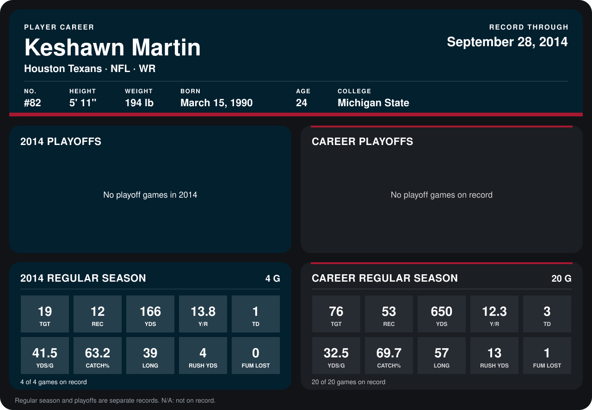

# Keshawn Martin

## Career stats

### Regular season

| Season | Team | Age | # | G | TGT | REC | YDS | Y/R | TD | YDS/G | CATCH% | LONG | RUSH YDS | FUM LOST |
|---|---|---:|---:|---:|---:|---:|---:|---:|---:|---:|---:|---:|---:|---:|
| 2013 | Houston Texans | 23 | 82 | 16 | 57 | 41 | 484 | 11.8 | 2 | 30.2 | 71.9 | 57 | 9 | 1 |
| 2014 | Houston Texans | 24 | 82 | 5 | 22 | 12 | 166 | 13.8 | 1 | 33.2 | 54.5 | 39 | 4 | 0 |
| **Career** |  |  |  | 21 | 79 | 53 | 650 | 12.3 | 3 | 31.0 | 67.1 | 57 | 13 | 1 |

### Playoffs

No playoff games on record.

## Awards

- AFC Special Teams Player of the Week (2013, Week 4)
- AFC Special Teams Player of the Week (2013, Week 7)
- AFC Special Teams Player of the Month (2013, September)

Age is his age on the league's opening game of each season; # is the number listed for him that season with that team (2014: the card's rule; 2013: the 2013 season roster), N/A where no listing applies.

Records through October 5, 2014. Identity: listed 2014 roster data, Weeks 1-4; number: 2014 Week 1 roster. [All Houston Texans players](README.md).
