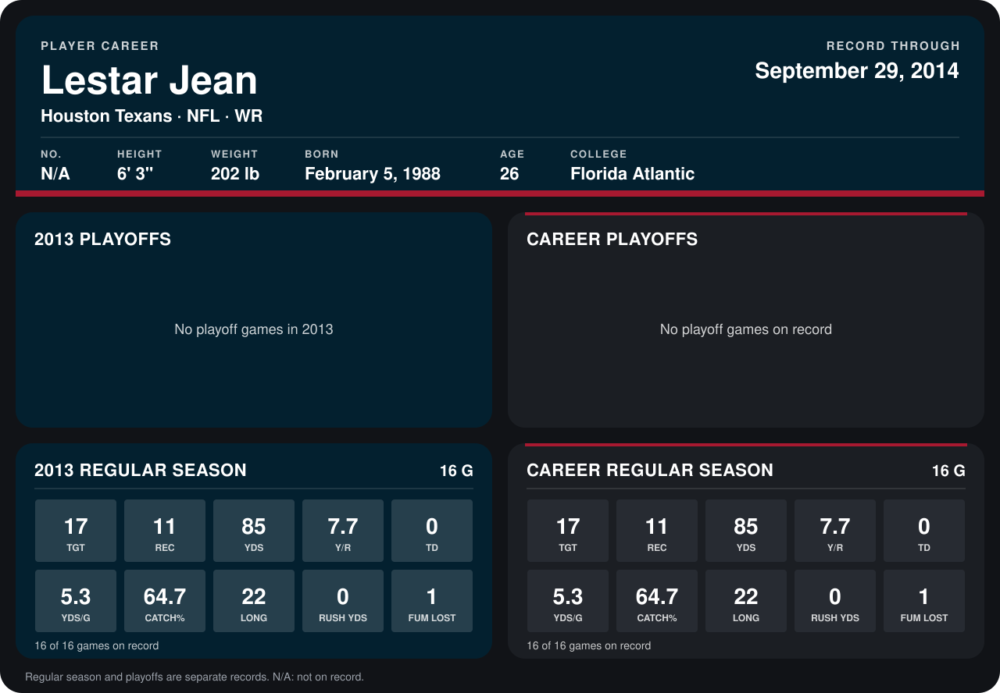

# Lestar Jean

## Career stats

### Regular season

| Season | Club | G | TGT | REC | YDS | Y/R | TD | YDS/G | CATCH% | LONG | RUSH YDS | FUM LOST |
|---|---|---:|---:|---:|---:|---:|---:|---:|---:|---:|---:|---:|
| 2013 | Houston Texans | 16 | 17 | 11 | 85 | 7.7 | 0 | 5.3 | 64.7 | 22 | 0 | 1 |
| **Career** |  | 16 | 17 | 11 | 85 | 7.7 | 0 | 5.3 | 64.7 | 22 | 0 | 1 |

### Playoffs

No playoff games on record.

## Awards

None on record.

Records through September 29, 2014. Identity: the public player file's latest listing (no 2014 Weeks 1-4 roster row). [All Houston Texans players](README.md).
