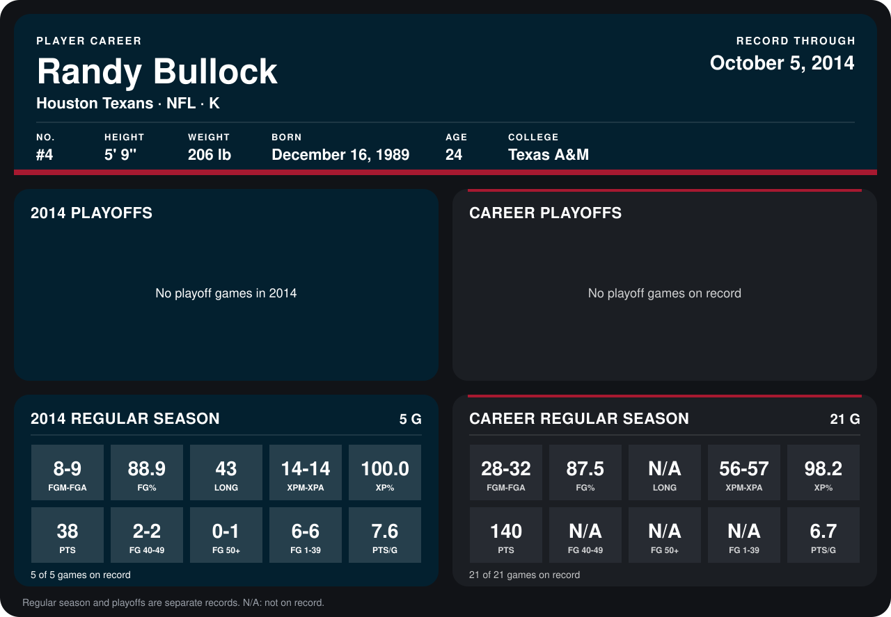

# Randy Bullock

## Career stats

### Regular season

| Season | Club | G | FGM-FGA | FG% | LONG | XPM-XPA | XP% | PTS | FG 40-49 | FG 50+ | FG 1-39 | PTS/G |
|---|---|---:|---:|---:|---:|---:|---:|---:|---:|---:|---:|---:|
| 2013 | Houston Texans | 16 | 20-23 | 87.0 | N/A | 42-43 | 97.7 | 102 | N/A | N/A | N/A | 6.4 |
| 2014 | Houston Texans | 5 | 8-9 | 88.9 | 43 | 14-14 | 100.0 | 38 | 2-2 | 0-1 | 6-6 | 7.6 |
| **Career** |  | 21 | 28-32 | 87.5 | N/A | 56-57 | 98.2 | 140 | N/A | N/A | N/A | 6.7 |

### Playoffs

No playoff games on record.

## Awards

None on record.

Records through October 5, 2014. Identity: listed 2014 roster data, Weeks 1-4; number: 2014 Week 1 roster. [All Houston Texans players](README.md).
