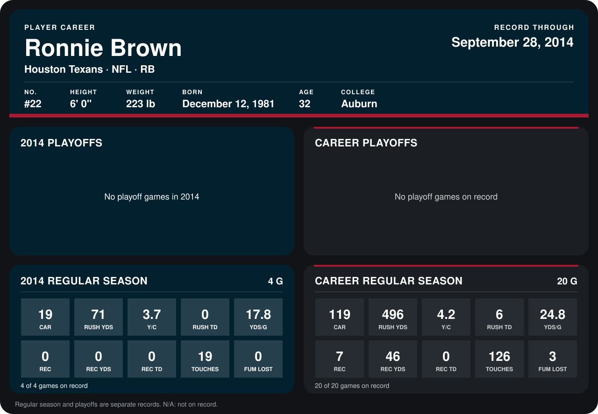

# Ronnie Brown

## Career stats

### Regular season

| Season | Club | G | CAR | RUSH YDS | Y/C | RUSH TD | YDS/G | REC | REC YDS | REC TD | TOUCHES | FUM LOST |
|---|---|---:|---:|---:|---:|---:|---:|---:|---:|---:|---:|---:|
| 2013 | San Diego Chargers | 16 | 100 | 425 | 4.2 | 6 | 26.6 | 7 | 46 | 0 | 107 | 3 |
| 2014 | Houston Texans | 4 | 19 | 71 | 3.7 | 0 | 17.8 | 0 | 0 | 0 | 19 | 0 |
| **Career** |  | 20 | 119 | 496 | 4.2 | 6 | 24.8 | 7 | 46 | 0 | 126 | 3 |

### Playoffs

No playoff games on record.

## Awards

None on record.

Records through October 5, 2014. Identity: listed 2014 roster data, Weeks 1-4; number: 2014 Week 1 roster. [All Houston Texans players](README.md).
