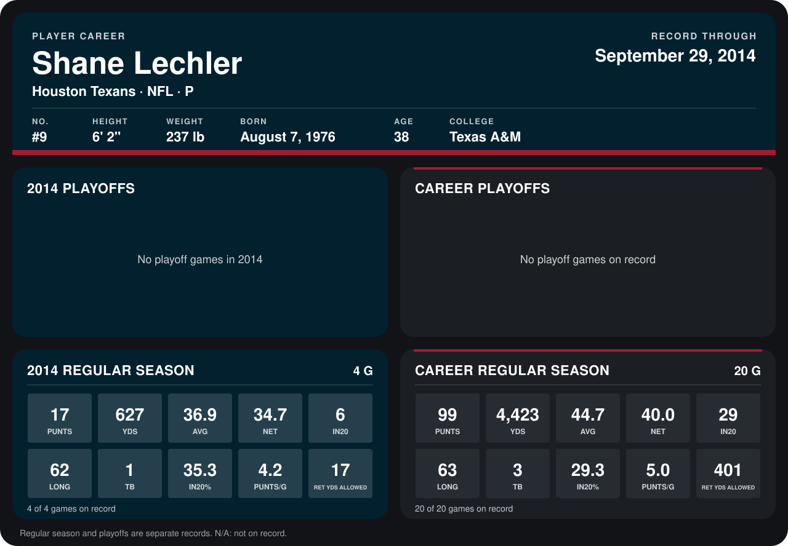

# Shane Lechler

## Career stats

### Regular season

| Season | Club | G | PUNTS | YDS | AVG | NET | IN20 | LONG | TB | IN20% | PUNTS/G | RET YDS ALLOWED |
|---|---|---:|---:|---:|---:|---:|---:|---:|---:|---:|---:|---:|
| 2013 | Houston Texans | 16 | 82 | 3,796 | 46.3 | 41.1 | 23 | 63 | 2 | 28.0 | 5.1 | 384 |
| 2014 | Houston Texans | 4 | 17 | 627 | 36.9 | 34.7 | 6 | 62 | 1 | 35.3 | 4.2 | 17 |
| **Career** |  | 20 | 99 | 4,423 | 44.7 | 40.0 | 29 | 63 | 3 | 29.3 | 5.0 | 401 |

### Playoffs

No playoff games on record.

## Awards

None on record.

Records through September 28, 2014. Identity: listed 2014 roster data, Weeks 1-4; number: 2014 Week 1 roster. [All Houston Texans players](README.md).
