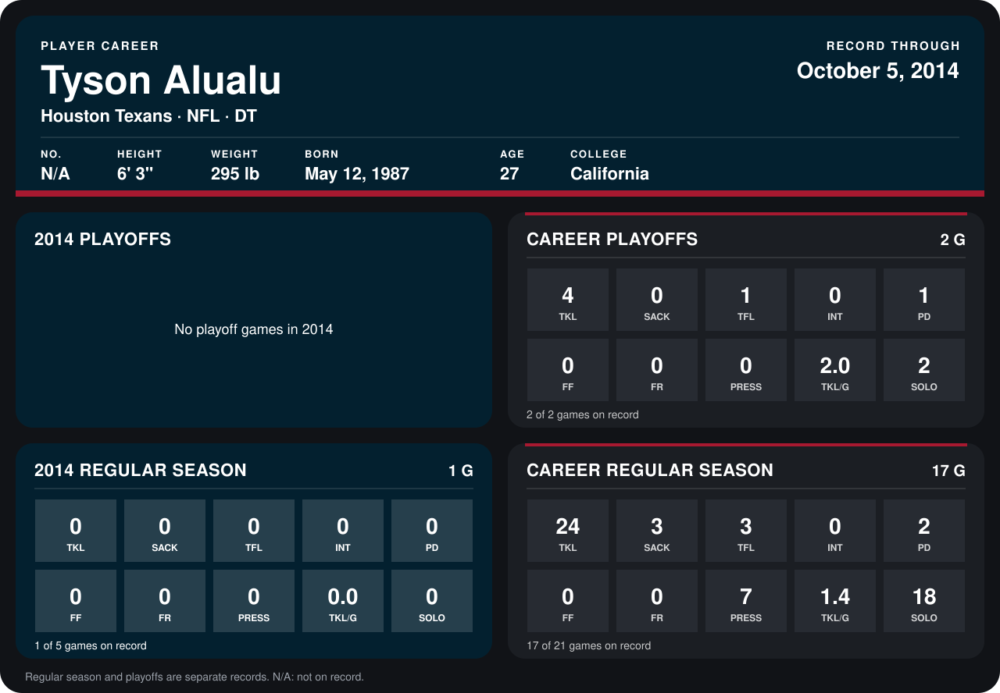

# Tyson Alualu

## Career stats

### Regular season

| Season | Team | Age | # | G | TKL | SACK | TFL | INT | PD | FF | FR | PRESS | TKL/G | SOLO |
|---|---|---:|---:|---:|---:|---:|---:|---:|---:|---:|---:|---:|---:|---:|
| 2013 | Jacksonville Jaguars | 26 | 93 | 16 | 24 | 3 | 3 | 0 | 2 | 0 | 0 | 7 | 1.5 | 18 |
| 2014 | Houston Texans | 27 | N/A | 1 | 0 | 0 | 0 | 0 | 0 | 0 | 0 | 0 | 0.0 | 0 |
| **Career** |  |  |  | 17 | 24 | 3 | 3 | 0 | 2 | 0 | 0 | 7 | 1.4 | 18 |

### Playoffs

| Season | Team | Age | # | G | TKL | SACK | TFL | INT | PD | FF | FR | PRESS | TKL/G | SOLO |
|---|---|---:|---:|---:|---:|---:|---:|---:|---:|---:|---:|---:|---:|---:|
| 2013 | Jacksonville Jaguars | 26 | 93 | 2 | 4 | 0 | 1 | 0 | 1 | 0 | 0 | 0 | 2.0 | 2 |
| **Career** |  |  |  | 2 | 4 | 0 | 1 | 0 | 1 | 0 | 0 | 0 | 2.0 | 2 |

## Awards

None on record.

Age is his age on the league's opening game of each season; # is the number listed for him that season with that team (2014: the card's rule; 2013: the 2013 season roster), N/A where no listing applies.

Records through October 5, 2014. Identity: listed 2014 roster data, Weeks 1-4. [All Houston Texans players](README.md).
