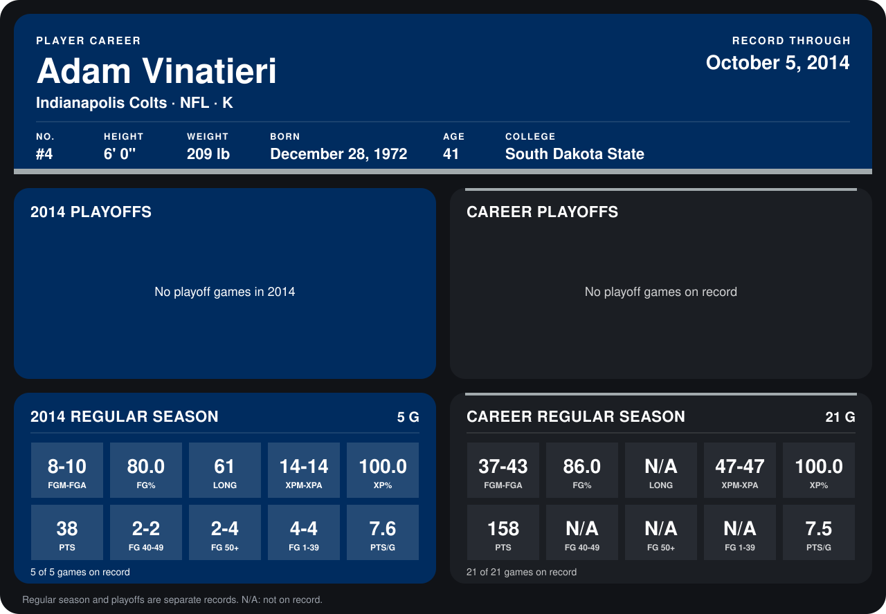

# Adam Vinatieri

## Career stats

### Regular season

| Season | Team | Age | # | G | FGM-FGA | FG% | LONG | XPM-XPA | XP% | PTS | FG 40-49 | FG 50+ | FG 1-39 | PTS/G |
|---|---|---:|---:|---:|---:|---:|---:|---:|---:|---:|---:|---:|---:|---:|
| 2013 | Indianapolis Colts | 40 | 4 | 16 | 29-33 | 87.9 | N/A | 33-33 | 100.0 | 120 | N/A | N/A | N/A | 7.5 |
| 2014 | Indianapolis Colts | 41 | 4 | 4 | 8-10 | 80.0 | 61 | 12-12 | 100.0 | 36 | 2-2 | 2-4 | 4-4 | 9.0 |
| **Career** |  |  |  | 20 | 37-43 | 86.0 | N/A | 45-45 | 100.0 | 156 | N/A | N/A | N/A | 7.8 |

### Playoffs

No playoff games on record.

## Awards

None on record.

Age is his age on the league's opening game of each season; # is the number listed for him that season with that team (2014: the card's rule; 2013: the 2013 season roster), N/A where no listing applies.

Records through September 28, 2014. Identity: listed 2014 roster data, Weeks 1-4; number: 2014 Week 1 roster. [All Indianapolis Colts players](README.md).
