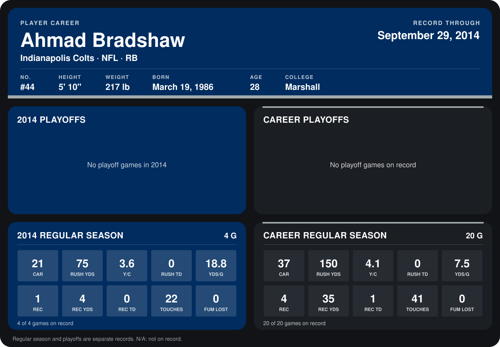

# Ahmad Bradshaw

## Career stats

### Regular season

| Season | Club | G | CAR | RUSH YDS | Y/C | RUSH TD | YDS/G | REC | REC YDS | REC TD | TOUCHES | FUM LOST |
|---|---|---:|---:|---:|---:|---:|---:|---:|---:|---:|---:|---:|
| 2013 | Indianapolis Colts | 16 | 16 | 75 | 4.7 | 0 | 4.7 | 3 | 31 | 1 | 19 | 0 |
| 2014 | Indianapolis Colts | 5 | 37 | 147 | 4.0 | 0 | 29.4 | 6 | 56 | 0 | 43 | 1 |
| **Career** |  | 21 | 53 | 222 | 4.2 | 0 | 10.6 | 9 | 87 | 1 | 62 | 1 |

### Playoffs

No playoff games on record.

## Awards

None on record.

Records through October 5, 2014. Identity: listed 2014 roster data, Weeks 1-4; number: 2014 Week 1 roster. [All Indianapolis Colts players](README.md).
