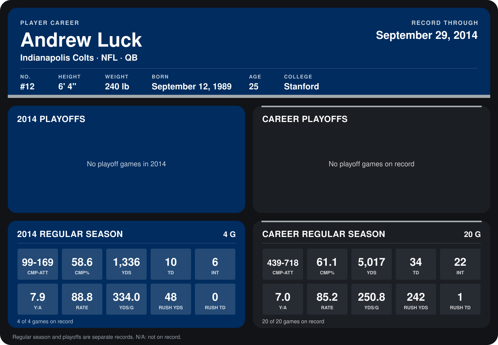

# Andrew Luck

## Career stats

### Regular season

| Season | Team | Age | # | G | CMP-ATT | CMP% | YDS | TD | INT | Y/A | RATE | YDS/G | RUSH YDS | RUSH TD |
|---|---|---:|---:|---:|---:|---:|---:|---:|---:|---:|---:|---:|---:|---:|
| 2013 | Indianapolis Colts | 23 | 12 | 16 | 340-549 | 61.9 | 3,681 | 24 | 16 | 6.7 | 84.1 | 230.1 | 194 | 1 |
| 2014 | Indianapolis Colts | 24 | 12 | 5 | 124-206 | 60.2 | 1,639 | 12 | 7 | 8.0 | 90.7 | 327.8 | 48 | 0 |
| **Career** |  |  |  | 21 | 464-755 | 61.5 | 5,320 | 36 | 23 | 7.0 | 85.9 | 253.3 | 242 | 1 |

### Playoffs

No playoff games on record.

## Awards

- AFC Offensive Player of the Week (2013, Week 11)

Age is his age on the league's opening game of each season; # is the number listed for him that season with that team (2014: the card's rule; 2013: the 2013 season roster), N/A where no listing applies.

Records through October 5, 2014. Identity: listed 2014 roster data, Weeks 1-4; number: 2014 Week 1 roster. [All Indianapolis Colts players](README.md).
