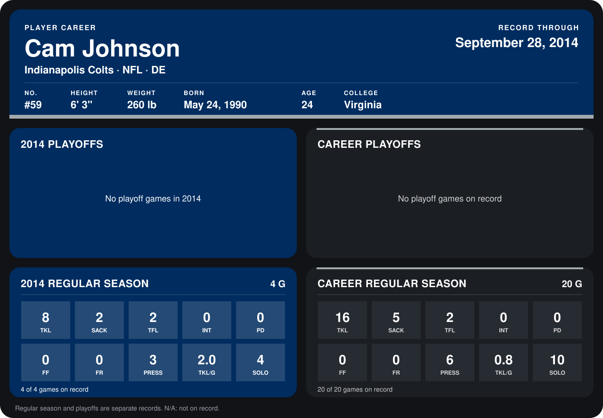

# Cam Johnson

## Career stats

### Regular season

| Season | Team | Age | # | G | TKL | SACK | TFL | INT | PD | FF | FR | PRESS | TKL/G | SOLO |
|---|---|---:|---:|---:|---:|---:|---:|---:|---:|---:|---:|---:|---:|---:|
| 2013 | Indianapolis Colts | 23 | 59 | 16 | 8 | 3 | 0 | 0 | 0 | 0 | 0 | 3 | 0.5 | 6 |
| 2014 | Indianapolis Colts | 24 | 59 | 4 | 8 | 2 | 2 | 0 | 0 | 0 | 0 | 3 | 2.0 | 4 |
| **Career** |  |  |  | 20 | 16 | 5 | 2 | 0 | 0 | 0 | 0 | 6 | 0.8 | 10 |

### Playoffs

No playoff games on record.

## Awards

None on record.

Age is his age on the league's opening game of each season; # is the number listed for him that season with that team (2014: the card's rule; 2013: the 2013 season roster), N/A where no listing applies.

Records through September 28, 2014. Identity: listed 2014 roster data, Weeks 1-4; number: 2014 Week 1 roster. [All Indianapolis Colts players](README.md).
