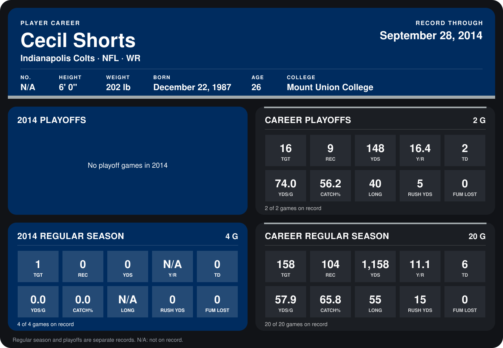

# Cecil Shorts

## Career stats

### Regular season

| Season | Club | G | TGT | REC | YDS | Y/R | TD | YDS/G | CATCH% | LONG | RUSH YDS | FUM LOST |
|---|---|---:|---:|---:|---:|---:|---:|---:|---:|---:|---:|---:|
| 2013 | Jacksonville Jaguars | 16 | 157 | 104 | 1,158 | 11.1 | 6 | 72.4 | 66.2 | 55 | 15 | 0 |
| 2014 | Indianapolis Colts | 4 | 1 | 0 | 0 | N/A | 0 | 0.0 | 0.0 | N/A | 0 | 0 |
| **Career** |  | 20 | 158 | 104 | 1,158 | 11.1 | 6 | 57.9 | 65.8 | 55 | 15 | 0 |

### Playoffs

| Season | Club | G | TGT | REC | YDS | Y/R | TD | YDS/G | CATCH% | LONG | RUSH YDS | FUM LOST |
|---|---|---:|---:|---:|---:|---:|---:|---:|---:|---:|---:|---:|
| 2013 | Jacksonville Jaguars | 2 | 16 | 9 | 148 | 16.4 | 2 | 74.0 | 56.2 | 40 | 5 | 0 |
| **Career** |  | 2 | 16 | 9 | 148 | 16.4 | 2 | 74.0 | 56.2 | 40 | 5 | 0 |

## Awards

None on record.

Records through September 29, 2014. Identity: listed 2014 roster data, Weeks 1-4; number: 2014 Week 1 roster. [All Indianapolis Colts players](README.md).
