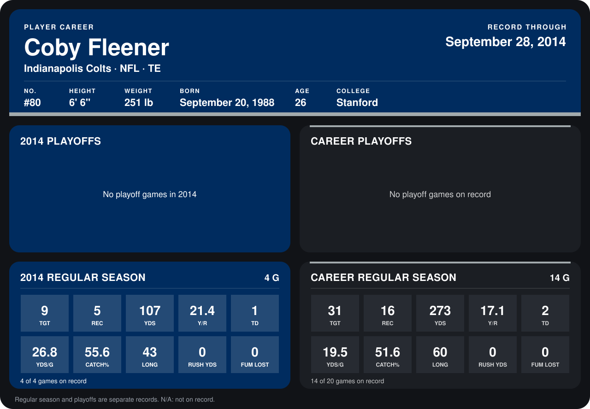

# Coby Fleener

## Career stats

### Regular season

| Season | Team | Age | # | G | TGT | REC | YDS | Y/R | TD | YDS/G | CATCH% | LONG | RUSH YDS | FUM LOST |
|---|---|---:|---:|---:|---:|---:|---:|---:|---:|---:|---:|---:|---:|---:|
| 2013 | Indianapolis Colts | 24 | 80 | 10 | 22 | 11 | 166 | 15.1 | 1 | 16.6 | 50.0 | 60 | 0 | 0 |
| 2014 | Indianapolis Colts | 25 | 80 | 4 | 9 | 5 | 107 | 21.4 | 1 | 26.8 | 55.6 | 43 | 0 | 0 |
| **Career** |  |  |  | 14 | 31 | 16 | 273 | 17.1 | 2 | 19.5 | 51.6 | 60 | 0 | 0 |

### Playoffs

No playoff games on record.

## Awards

None on record.

Age is his age on the league's opening game of each season; # is the number listed for him that season with that team (2014: the card's rule; 2013: the 2013 season roster), N/A where no listing applies.

Records through September 28, 2014. Identity: listed 2014 roster data, Weeks 1-4; number: 2014 Week 1 roster. [All Indianapolis Colts players](README.md).
