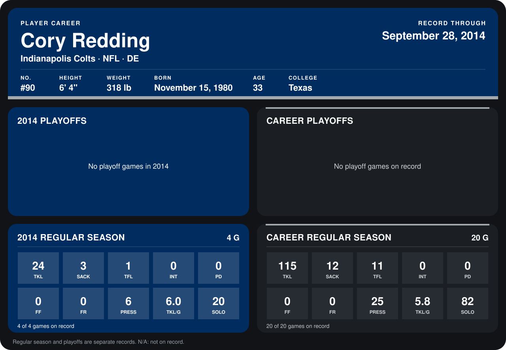

# Cory Redding

## Career stats

### Regular season

| Season | Club | G | TKL | SACK | TFL | INT | PD | FF | FR | PRESS | TKL/G | SOLO |
|---|---|---:|---:|---:|---:|---:|---:|---:|---:|---:|---:|---:|
| 2013 | Indianapolis Colts | 16 | 91 | 9 | 10 | 0 | 0 | 0 | 0 | 19 | 5.7 | 62 |
| 2014 | Indianapolis Colts | 4 | 24 | 3 | 1 | 0 | 0 | 0 | 0 | 6 | 6.0 | 20 |
| **Career** |  | 20 | 115 | 12 | 11 | 0 | 0 | 0 | 0 | 25 | 5.8 | 82 |

### Playoffs

No playoff games on record.

## Awards

None on record.

Records through September 29, 2014. Identity: listed 2014 roster data, Weeks 1-4; number: 2014 Week 1 roster. [All Indianapolis Colts players](README.md).
