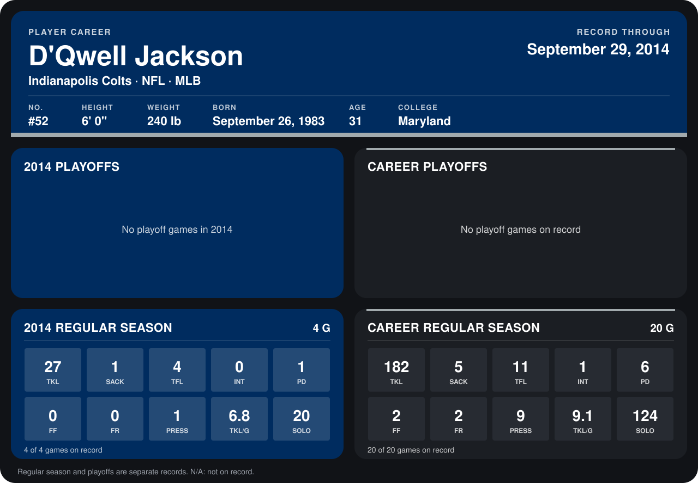

# D'Qwell Jackson

## Career stats

### Regular season

| Season | Club | G | TKL | SACK | TFL | INT | PD | FF | FR | PRESS | TKL/G | SOLO |
|---|---|---:|---:|---:|---:|---:|---:|---:|---:|---:|---:|---:|
| 2013 | Cleveland Browns | 16 | 155 | 4 | 7 | 1 | 5 | 2 | 2 | 8 | 9.7 | 104 |
| 2014 | Indianapolis Colts | 4 | 27 | 1 | 4 | 0 | 1 | 0 | 0 | 1 | 6.8 | 20 |
| **Career** |  | 20 | 182 | 5 | 11 | 1 | 6 | 2 | 2 | 9 | 9.1 | 124 |

### Playoffs

No playoff games on record.

## Awards

- AFC Defensive Player of the Week (2013, Week 9)

Records through September 28, 2014. Identity: listed 2014 roster data, Weeks 1-4; number: 2014 Week 1 roster. [All Indianapolis Colts players](README.md).
