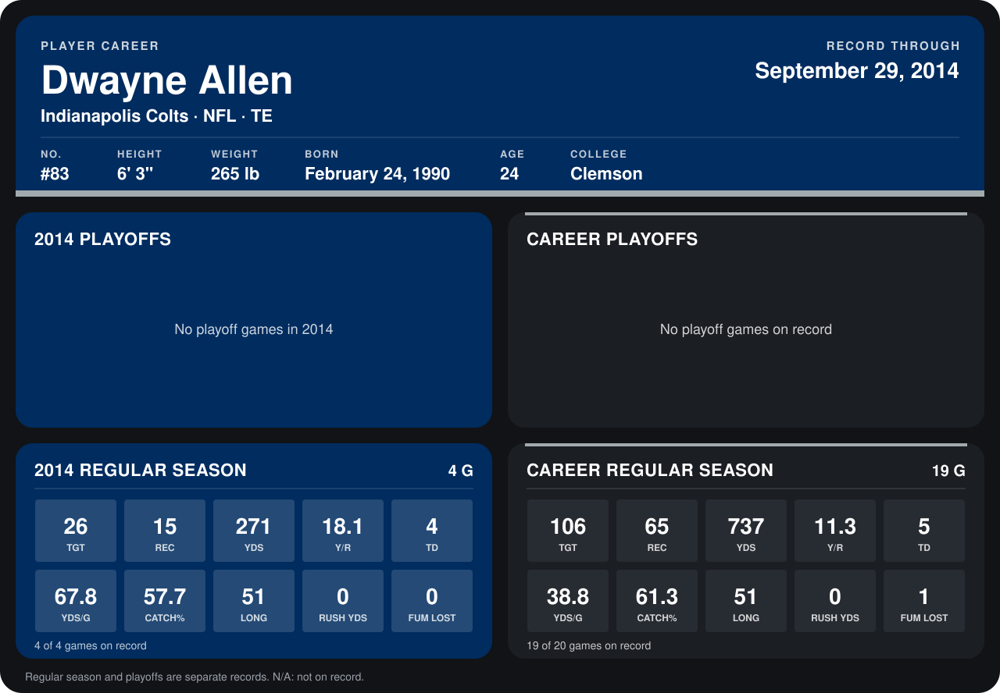

# Dwayne Allen

## Career stats

### Regular season

| Season | Club | G | TGT | REC | YDS | Y/R | TD | YDS/G | CATCH% | LONG | RUSH YDS | FUM LOST |
|---|---|---:|---:|---:|---:|---:|---:|---:|---:|---:|---:|---:|
| 2013 | Indianapolis Colts | 15 | 80 | 50 | 466 | 9.3 | 1 | 31.1 | 62.5 | 36 | 0 | 1 |
| 2014 | Indianapolis Colts | 5 | 35 | 20 | 324 | 16.2 | 6 | 64.8 | 57.1 | 51 | 0 | 0 |
| **Career** |  | 20 | 115 | 70 | 790 | 11.3 | 7 | 39.5 | 60.9 | 51 | 0 | 1 |

### Playoffs

No playoff games on record.

## Awards

None on record.

Records through October 5, 2014. Identity: listed 2014 roster data, Weeks 1-4; number: 2014 Week 1 roster. [All Indianapolis Colts players](README.md).
