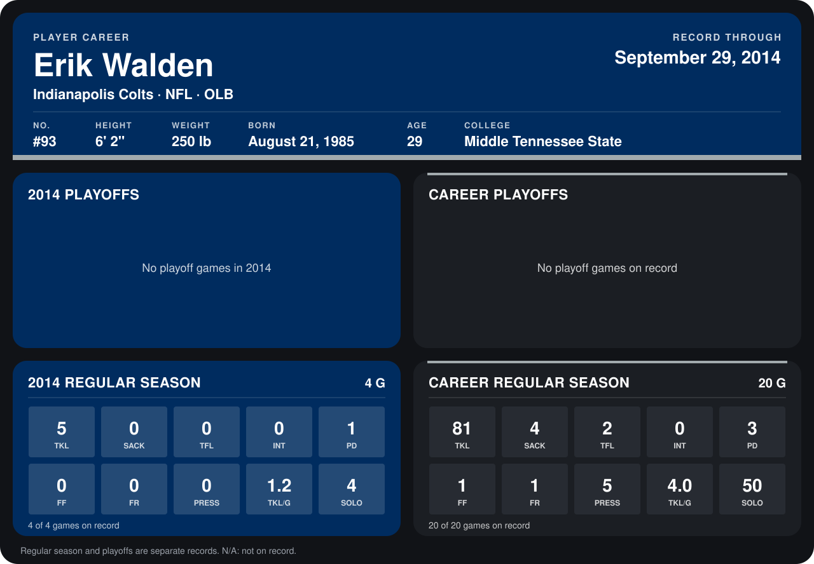

# Erik Walden

## Career stats

### Regular season

| Season | Club | G | TKL | SACK | TFL | INT | PD | FF | FR | PRESS | TKL/G | SOLO |
|---|---|---:|---:|---:|---:|---:|---:|---:|---:|---:|---:|---:|
| 2013 | Indianapolis Colts | 16 | 76 | 4 | 2 | 0 | 2 | 1 | 1 | 5 | 4.8 | 46 |
| 2014 | Indianapolis Colts | 5 | 6 | 0 | 0 | 0 | 1 | 0 | 0 | 0 | 1.2 | 5 |
| **Career** |  | 21 | 82 | 4 | 2 | 0 | 3 | 1 | 1 | 5 | 3.9 | 51 |

### Playoffs

No playoff games on record.

## Awards

None on record.

Records through October 5, 2014. Identity: listed 2014 roster data, Weeks 1-4; number: 2014 Week 1 roster. [All Indianapolis Colts players](README.md).
