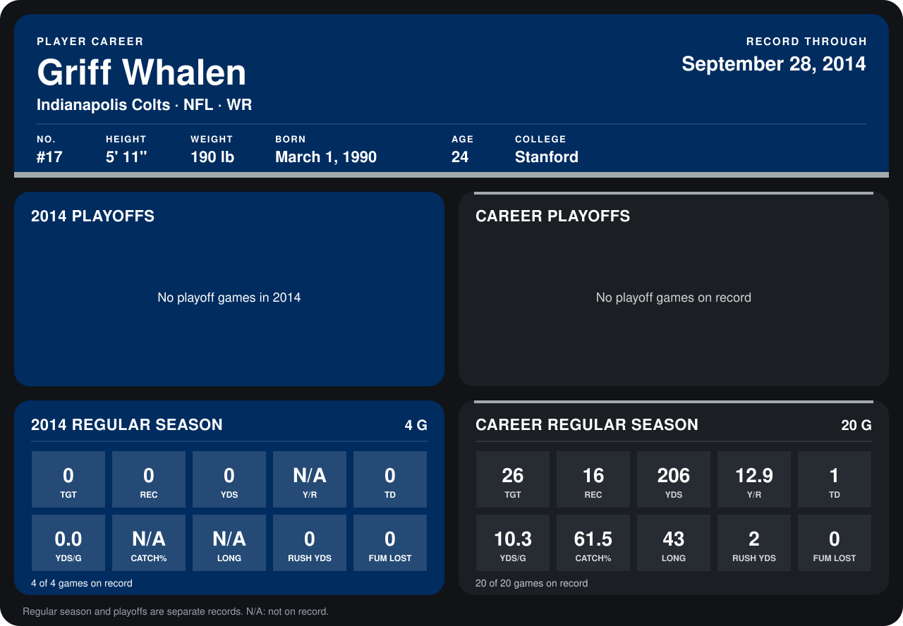

# Griff Whalen

## Career stats

### Regular season

| Season | Club | G | TGT | REC | YDS | Y/R | TD | YDS/G | CATCH% | LONG | RUSH YDS | FUM LOST |
|---|---|---:|---:|---:|---:|---:|---:|---:|---:|---:|---:|---:|
| 2013 | Indianapolis Colts | 16 | 26 | 16 | 206 | 12.9 | 1 | 12.9 | 61.5 | 43 | 2 | 0 |
| 2014 | Indianapolis Colts | 5 | 1 | 0 | 0 | N/A | 0 | 0.0 | 0.0 | N/A | 0 | 1 |
| **Career** |  | 21 | 27 | 16 | 206 | 12.9 | 1 | 9.8 | 59.3 | 43 | 2 | 1 |

### Playoffs

No playoff games on record.

## Awards

None on record.

Records through October 5, 2014. Identity: listed 2014 roster data, Weeks 1-4; number: 2014 Week 1 roster. [All Indianapolis Colts players](README.md).
