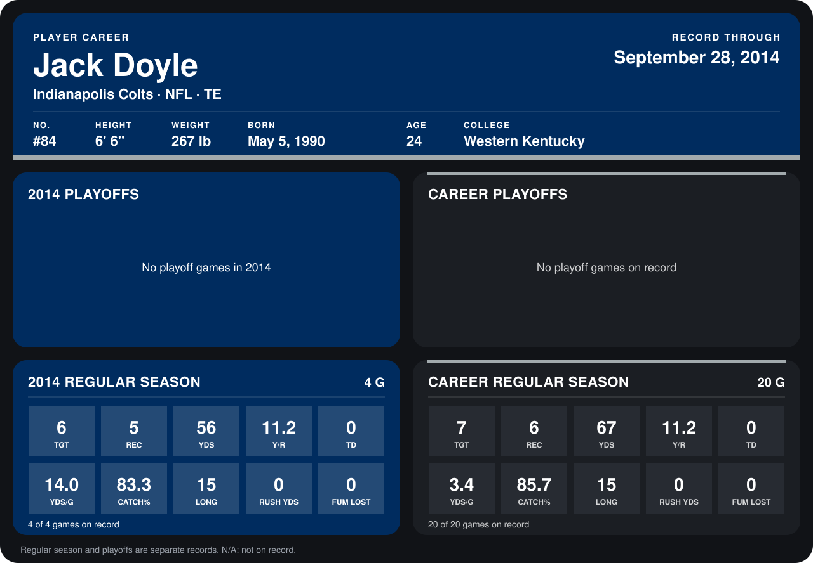

# Jack Doyle

## Career stats

### Regular season

| Season | Club | G | TGT | REC | YDS | Y/R | TD | YDS/G | CATCH% | LONG | RUSH YDS | FUM LOST |
|---|---|---:|---:|---:|---:|---:|---:|---:|---:|---:|---:|---:|
| 2013 | Indianapolis Colts | 16 | 1 | 1 | 11 | 11.0 | 0 | 0.7 | 100.0 | 11 | 0 | 0 |
| 2014 | Indianapolis Colts | 5 | 6 | 5 | 56 | 11.2 | 0 | 11.2 | 83.3 | 15 | 0 | 0 |
| **Career** |  | 21 | 7 | 6 | 67 | 11.2 | 0 | 3.2 | 85.7 | 15 | 0 | 0 |

### Playoffs

No playoff games on record.

## Awards

None on record.

Records through October 5, 2014. Identity: listed 2014 roster data, Weeks 1-4; number: 2014 Week 1 roster. [All Indianapolis Colts players](README.md).
