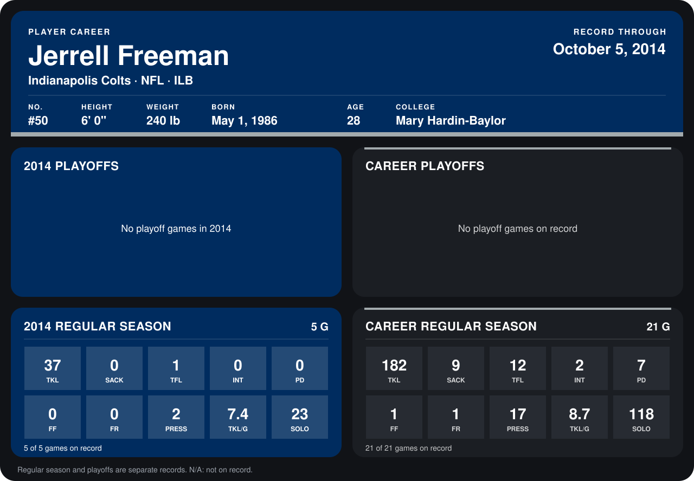

# Jerrell Freeman

## Career stats

### Regular season

| Season | Club | G | TKL | SACK | TFL | INT | PD | FF | FR | PRESS | TKL/G | SOLO |
|---|---|---:|---:|---:|---:|---:|---:|---:|---:|---:|---:|---:|
| 2013 | Indianapolis Colts | 16 | 145 | 9 | 11 | 2 | 7 | 1 | 1 | 15 | 9.1 | 95 |
| 2014 | Indianapolis Colts | 4 | 30 | 0 | 0 | 0 | 0 | 0 | 0 | 2 | 7.5 | 19 |
| **Career** |  | 20 | 175 | 9 | 11 | 2 | 7 | 1 | 1 | 17 | 8.8 | 114 |

### Playoffs

No playoff games on record.

## Awards

- AFC Defensive Player of the Week (2013, Week 10)
- AFC Defensive Player of the Month (2013, November)
- AP Second-Team All-Pro (2013, ILB)

Records through September 28, 2014. Identity: listed 2014 roster data, Weeks 1-4; number: 2014 Week 1 roster. [All Indianapolis Colts players](README.md).
