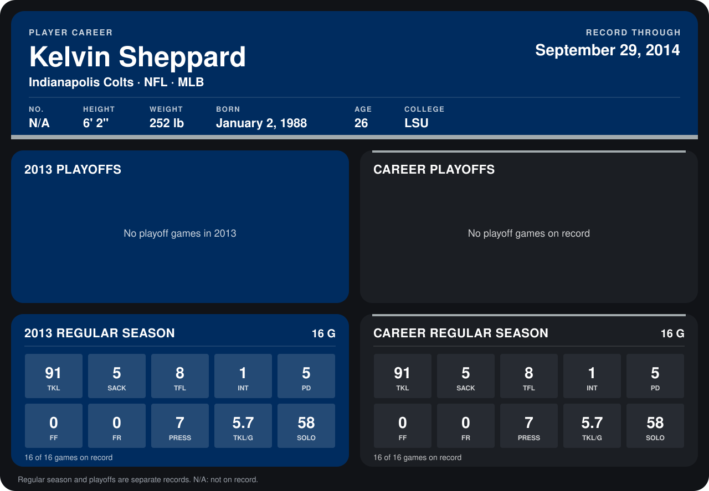

# Kelvin Sheppard

## Career stats

### Regular season

| Season | Club | G | TKL | SACK | TFL | INT | PD | FF | FR | PRESS | TKL/G | SOLO |
|---|---|---:|---:|---:|---:|---:|---:|---:|---:|---:|---:|---:|
| 2013 | Indianapolis Colts | 16 | 91 | 5 | 8 | 1 | 5 | 0 | 0 | 7 | 5.7 | 58 |
| **Career** |  | 16 | 91 | 5 | 8 | 1 | 5 | 0 | 0 | 7 | 5.7 | 58 |

### Playoffs

No playoff games on record.

## Awards

None on record.

Records through September 29, 2014. Identity: listed 2014 roster data, Weeks 1-4. [All Indianapolis Colts players](README.md).
